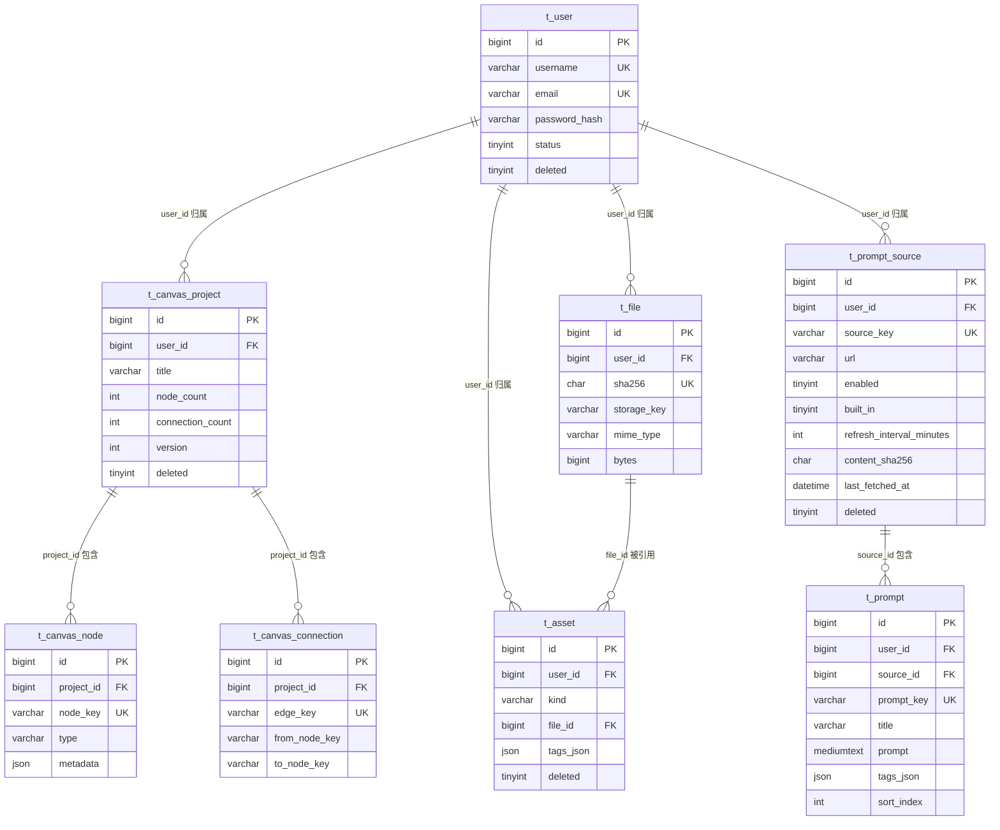

# 数据库表结构说明（阶段 0 ~ 4）

> 本文档覆盖当前已建成的**全部 8 张表**，按阶段顺序组织，逐字段说明用途、约束与设计理由，并给出表与表之间的关联关系。
>
> - 权威来源：`src/main/resources/db/schema.sql`（应用每次启动自动执行，全部 `CREATE TABLE IF NOT EXISTS`）
> - 实体来源：`com.infinitecanvas.canvas.entity.*`
> - 若本文档与 `schema.sql` 不一致，**以 `schema.sql` 为准**，并请回头修正本文档。
> - 最后更新：2026-11-18（阶段 4 完成时）

---

## 一、怎么读这份文档

- **第二节**是全景图，先看它建立整体印象：有哪几张表、谁连谁。
- **第三节**是所有表都要遵守的通用约定（主键、时间、逻辑删除、命名）。这一节最省事，读完后面就不需要重复解释。
- **第四 ~ 七节**按阶段讲表：每个字段的用途 + 索引 + 这块为什么这么设计。
- **第八节**是索引总表，把 8 张表的所有索引列在一起，标出每个索引被哪条 SQL 用到。
- **第九节**是典型查询的执行路径，用来判断索引是否真的有效。
- **第十、十一节**是数据量估算、已知问题与改进方向。面试被追问"这里有什么坑"时基本都在这两节。

---

## 二、全局视图

### 2.1 表清单

| # | 表名 | 阶段 | 一句话定位 | 是否有逻辑删除 | 是否聚合根 |
| --- | --- | --- | --- | --- | --- |
| 1 | `t_user` | 1 账号体系 | 账号、密码哈希、登录轨迹 | 有 | 是 |
| 2 | `t_canvas_project` | 2 画布项目 | 画布的元信息 + 视口 + 版本号 | 有 | 是 |
| 3 | `t_canvas_node` | 2 画布项目 | 画布上的节点（图片/文本/配置…） | 无 | 否，隶属项目 |
| 4 | `t_canvas_connection` | 2 画布项目 | 节点之间的连线 | 无 | 否，隶属项目 |
| 5 | `t_file` | 3 文件与素材 | 一次上传的产物（内容寻址 + 秒传去重） | 无 | 否，被素材引用 |
| 6 | `t_asset` | 3 文件与素材 | 业务素材：文本/图片/视频/音频 | 有 | 是 |
| 7 | `t_prompt_source` | 4 提示词库 | 提示词来源仓库 + 同步状态 | 有 | 是 |
| 8 | `t_prompt` | 4 提示词库 | 从源同步下来的提示词条目 | 无 | 否，隶属源 |

**为什么是这 8 张**：本项目的核心对象只有五个——人、画布、画布内容、媒体文件、提示词。AI 生成任务（阶段 5+）、会话（阶段 7）会在此基础上继续加表，届时本文档按同样格式追加一节。

注意阶段 4 的"父子"和阶段 2/3 不一样：阶段 2 的父是**用户自己的作品**（`t_canvas_project`），阶段 4 的父是**一份外部数据源的配置**（`t_prompt_source`）——提示词不是用户创建的，而是服务器定时从别人仓库里抓来的。这个差别决定了两张表的删除策略和唯一键设计（见 7.2）。

### 2.2 关系总图

```
                         ┌──────────────┐
                         │   t_user     │
                         │  (聚合根)     │
                         └──────┬───────┘
                    user_id     │     user_id
              ┌─────────────────┼──────────────────┐
              │                 │                  │
              ▼                 ▼                  ▼
   ┌────────────────────┐  ┌──────────┐   ┌──────────────┐
   │ t_canvas_project   │  │  t_file  │◄──┤   t_asset    │
   │   (聚合根)          │  │ (内容寻址)│   │  (聚合根)     │
   └─────────┬──────────┘  └──────────┘   └──────────────┘
             │ project_id        ▲              │
      ┌──────┴───────┐           │              │ file_id (逻辑外键)
      ▼              ▼           └──────────────┘
┌──────────────┐ ┌──────────────────┐
│ t_canvas_node│ │t_canvas_connection│
│  (隶属数据)   │ │   (隶属数据)      │
└──────────────┘ └──────────────────┘
        └──── from_node_key / to_node_key 指向 node_key（逻辑引用）────┘
```

阶段 4 新增的两张表也是一棵树，但它是**独立于上面那棵树**的（提示词和画布、素材之间目前没有关联）：

```
                    t_user
                      │ user_id
                      ▼
          ┌───────────────────────┐
          │   t_prompt_source     │  ← 聚合根：一个外部仓库 + 它的同步状态
          │   (聚合根)             │     每行有自己的刷新间隔、ETag、上次摘要
          └───────────┬───────────┘
                      │ source_id
                      ▼
          ┌───────────────────────┐
          │      t_prompt         │  ← 隶属数据：一次同步抓下来的条目
          │     (隶属数据)         │     (source_id, prompt_key) 唯一定位
          └───────────────────────┘      没有任何独立接口，只能靠"同步"整体写入
```

**为什么两个聚合根都挂在 `t_user` 下**：提示词源是"每个用户自己配的来源清单"。内置的 7 个源也是**按用户各插一份**（见 7.5），不是全站共享一张配置表。这样"我停用某个内置源"不会影响别人，代价是 `t_prompt` 的数据量 = 用户数 × 源数 × 每个源的条目数——在千级用户、万级条目的量级下可以接受，真要省空间应该把"源的元数据"和"用户的订阅关系"拆成两张表，但那是另一个阶段的复杂度。

Mermaid 版本（GitHub / 支持 Mermaid 的编辑器可直接渲染）：



### 2.3 三个"关系"要分清

这份表结构里同时存在三种不同强度的关系，混在一起就容易设计错：

| 关系类型 | 表现 | 例子 | 特点 |
| --- | --- | --- | --- |
| **归属关系** | 有 `user_id` / `project_id`，查询必带 | `t_canvas_node.project_id` | 一对一归属，用来做越权校验和分片，永远是查询第一条件 |
| **引用关系** | 存对方的**业务键**而不是主键 | `t_canvas_connection.from_node_key` → `t_canvas_node.node_key` | 对方主键会变，业务键不会 |
| **派生关系** | 存对方的**快照值**，允许不同步 | `t_asset.bytes` 冗余自 `t_file.bytes`；`t_prompt_source.prompt_count` 冗余自 `COUNT(t_prompt)` | 读多写少，用一致性换查询性能 |

数据表里**没有一条物理外键**（原因见 3.8），上面所有箭头都是逻辑关系，靠代码和索引保证。

---

## 三、跨表通用约定

这一节是所有表共同遵守的规则。后面讲单表时不再重复解释。

### 3.1 主键：统一 BIGINT + 雪花 ID

```sql
id BIGINT NOT NULL COMMENT '主键，MyBatis-Plus 雪花 ID'
PRIMARY KEY (id)
```

三个决定：

1. **不用自增**。自增 ID 会泄露业务量（用户能算出"你们一共多少张画布"），而且分库分表后没法用。雪花 ID 是 64 位 long，趋势递增，索引友好。
2. **不用 UUID**。UUID 是 36 字符字符串，做主键会让 InnoDB 的聚簇索引变大（每个二级索引都要存主键），而且随机分布导致频繁页分裂。雪花 ID 只占 8 字节且大致有序。
3. **不用 `AUTO_INCREMENT` + `ASSIGN_ID` 混搭**。全局配置 `mybatis-plus.global-config.db-config.id-type: assign_id`，实体上再显式标 `@TableId(type = IdType.ASSIGN_ID)`，两层都写是为了别人改全局配置时不会静默变化。

> **面试点**：雪花 ID 的 64 位怎么分？1 位符号 + 41 位毫秒时间戳（约 69 年）+ 10 位机器 ID（1024 台）+ 12 位序列号（同毫秒 4096 个）。所以**单机每毫秒最多 4096 个 ID**，超出会等到下一毫秒。风险是时钟回拨，MyBatis-Plus 的 `DefaultIdentifierGenerator` 在检测到回拨时会直接抛异常而不是生成重复 ID。

### 3.2 业务键 vs 数据库主键（阶段 2、3 的核心思想）

前端传过来的 id（`node_key`、`edge_key`）是**业务键**，数据库主键是**内部实现**。两者分离：

| | 数据库主键 `id` | 业务键 `node_key` |
| --- | --- | --- |
| 谁生成 | 后端雪花算法 | 前端（nanoid 之类） |
| 会不会变 | 每次保存快照都重新生成 | 画布生命周期内不变 |
| 对外暴露 | **绝不**返回给前端 | 出参里的 `id` 就是它 |
| 用途 | 物理行标识 | 逻辑引用、前端渲染 key |

**为什么保存快照每次都要重新生成主键**：保存是"整份替换"（delete 全部 → 批量 insert），新插入的行就是新主键。如果前端手里拿着数据库主键，保存一次之后全部失效。所以对外只认业务键。

> **推论**：`t_canvas_connection` 里的 `from_node_key` / `to_node_key` **必须**存 `node_key`。如果存 `node.id`，保存快照后所有连线都会指向不存在的节点——这是这个数据模型里最容易踩的坑。

### 3.3 时间列：谁有 `updated_at`，谁没有

| 表 | `created_at` | `updated_at` | 理由 |
| --- | --- | --- | --- |
| `t_user` | ✅ | ✅ | 改昵称/头像/登录时间都要刷新 |
| `t_canvas_project` | ✅ | ✅ | 重命名、保存快照都要刷新 |
| `t_canvas_node` | ✅ | ✅ | 单行看有 `updated_at`，实际随快照整体重建 |
| `t_canvas_connection` | ✅ | ❌ | 连线只有"存在/不存在"，没有"修改"语义 |
| `t_file` | ✅ | ❌ | 内容寻址，字节永远不会变，没有更新场景 |
| `t_asset` | ✅ | ✅ | 改标题/备注/标签 |
| `t_prompt_source` | ✅ | ✅ | 改备注名/间隔、每次同步都要刷 `last_fetched_at`、`last_error` |
| `t_prompt` | ✅ | ❌ | 内容完全来自远端，本地不存在"修改"语义；唯一的写入是 upsert，靠 `remote_updated_at` 表达远端变更 |

约定：

- 列类型统一 `DATETIME`（**不是** `TIMESTAMP`）。`TIMESTAMP` 有 2038 年上限，且受会话时区影响；`DATETIME` 存的是"墙上时间"，配合统一 `Asia/Shanghai` 更可控。
- 默认值交给 MySQL：`DEFAULT CURRENT_TIMESTAMP` / `ON UPDATE CURRENT_TIMESTAMP`，这样用 SQL 客户端直接插数据也不会漏。
- 应用层**同时**用 MyBatis-Plus 的 `@TableField(fill = FieldFill.INSERT)` / `INSERT_UPDATE` 兜底，由 `AuditMetaObjectHandler` 填充。
- ⚠️ **已知坑**：`FieldFill.INSERT_UPDATE` 在 `update` 场景几乎不生效（字段是从数据库查出来的，已有旧值，自动填充判定为"非空不覆盖"）。所以 `t_canvas_project.updated_at` 在保存快照时是用 `setFieldValByName("updatedAt", ...)` 强制覆盖的，不能指望注解。

### 3.4 逻辑删除：三种策略并存，别一刀切

这是本表结构里最容易被问"为什么不统一"的地方。

| 策略 | 用在 | 表 | 理由 |
| --- | --- | --- | --- |
| **有 `deleted` 列** | 有回收站语义的聚合根 | `t_user`、`t_canvas_project`、`t_asset` | 用户误删要能恢复；历史作品不能真消失 |
| **无 `deleted`，随父级** | 隶属数据 | `t_canvas_node`、`t_canvas_connection` | 节点没有独立生命周期，父项目删了它就不该被查；恢复项目时节点还在（因为是逻辑删除，物理行没动） |
| **无 `deleted`，真删** | 技术资源 | `t_file` | 文件没有"回收站"概念；磁盘是否删除由 `t_asset` 的引用情况决定，见 6.4 |

阶段 4 的两张表落在了前两类上，但**父有 `deleted`、子没有**这一点值得单独说明：

| 表 | 策略 | 理由 |
| --- | --- | --- |
| `t_prompt_source` | 有 `deleted` | 用户删掉一个源后可能想恢复（尤其内置源手滑停用/删除），且"曾经配过哪些源"本身是有价值的信息 |
| `t_prompt` | 无 `deleted`，随父级 | 提示词是从远端同步来的**副本**，源恢复后重新同步一次就全回来了，没有"恢复单条旧提示词"的需求。留着 `deleted=0` 的行反而会让列表接口必须天天过滤，白付索引代价 |

两个直接后果：

1. **删源时子表要物理删**：`DELETE FROM t_prompt WHERE source_id = ?`，不能只把源标记成 `deleted=1`——否则同一份提示词会挂在"已删除的源"下面继续被扫出来（除非每次查询都 join 判断源的 `deleted`，那等于给自己加一道永远为真的条件）。
2. **`t_prompt` 的查询必须靠"源已启用"来隔离**，而不是靠自己的删除标记。所以列表接口的第一步是先把该用户**启用中**的 `source_id` 查出来，再 `WHERE source_id IN (...)`。这一步顺便实现了"停用某个源 = 它的提示词从列表消失，但数据还在，重新启用立刻回来"。


MyBatis-Plus 全局配置：

```yaml
logic-delete-field: deleted
logic-delete-value: 1
logic-not-delete-value: 0
```

也就是说：

- 所有 `SELECT` 自动追加 `deleted = 0`（`@TableLogic` 字段声明在实体上）；
- `deleteById()` 自动变成 `UPDATE ... SET deleted = 1`；
- **绕过它的两条路**：手写 XML 的 `selectTrash`（查回收站必须看到 `deleted = 1`）、`restore`（手写 `UPDATE ... SET deleted = 0`）。这两条是不可能用 Wrapper 表达的，所以必须落在 XML 里。

> ⚠️ **逻辑删除与唯一索引的冲突**（`t_user` 已有此问题）：`uk_user_username` 只有 `username` 一列，用户逻辑删除后行还在，这个用户名**永久被占用**，无法重新注册。当前是"账号不可复用"的产品设定，所以能接受。如果要支持复用，得把唯一索引改成 `(username, deleted)` 并且在删除时把 `username` 改写成 `xxx_deleted_<id>`——MySQL 的唯一索引允许多个 `NULL`，但不允许多个 `1`。

### 3.5 归属字段：`user_id` 是每条查询的第一条件

- 每张业务表都有 `user_id`（`t_canvas_node` / `t_canvas_connection` 没有，它们的归属通过 `project_id` 间接得到——这是**有意的冗余削减**，避免同一条数据两处归属不一致）。
- **反向的冗余也存在**：`t_prompt.source_id` 已经能通过父表推出归属，但这一列仍然保留了 `user_id`。因为提示词列表的每一条查询都是 `WHERE user_id = ? AND source_id IN (...)`，如果只存 `source_id`，就得先 join 父表或者先查出源 id 列表——前者让一个本该走单表索引的查询变成关联查询，后者在"源很多"时会拼出很长的 `IN`。多存 8 字节换掉一次 join，是划算的。**代价是两处归属可能不一致**，所以写入时 `user_id` 一律从父源对象里取（`source.getUserId()`），绝不从请求参数取。
- **归属只从 JWT 里取**，`SecurityUtils.currentUserId()`，任何 DTO 里都不允许出现 `userId` 字段。前端传什么都不影响归属。
- 越权统一返回 **404 + 40410**，不用 403。理由：403 等于告诉攻击者"这个 id 存在，只是不属于你"，是可以用来枚举的侧信道。

### 3.6 命名规范

| 对象 | 规范 | 例子 |
| --- | --- | --- |
| 表名 | `t_` 前缀 + 小写下划线 | `t_canvas_project` |
| 主键 | 一律 `id` | — |
| 归属外键 | `{实体}_id` | `user_id`、`project_id`、`file_id` |
| 业务键 | `{实体}_key` | `node_key`、`edge_key` |
| 布尔语义 | `is_` / 动词开头，TINYINT 0/1 | `show_image_info`、`deleted` |
| JSON 列 | `xxx_json` 后缀，显式提示"这是 JSON 不是字符串" | `tags_json`、`metadata_json` |
| 唯一索引 | `uk_{表简称}_{列}` | `uk_user_username`、`uk_file_user_sha` |
| 普通索引 | `idx_{表简称}_{列}` | `idx_project_user_updated` |

Java 侧靠 `map-underscore-to-camel-case: true` 自动映射，实体上**没有**逐个写 `@TableField("xxx")`，只有真正不同名或需要特殊处理的字段才标注解。

### 3.7 字符集与存储引擎

```sql
ENGINE = InnoDB DEFAULT CHARSET = utf8mb4 COLLATE = utf8mb4_0900_ai_ci
```

- **必须 utf8mb4**：`utf8`（utf8mb3）最多 3 字节，存不了 emoji。用户昵称、素材标题里 emoji 很常见。
- **InnoDB**：需要事务、行锁、MVCC。
- **`utf8mb4_0900_ai_ci`**：MySQL 8 默认排序规则，`ai` = accent insensitive（`é` 与 `e` 相等），`ci` = case insensitive。所以 `WHERE username = 'Demo'` 能查到 `demo`——**登录名不区分大小写是这里带来的，不是代码做的**。

### 3.8 为什么一条物理外键都不建

| 维度 | 建外键 | 不建（当前选择） |
| --- | --- | --- |
| 数据一致性 | 数据库强保证 | 应用层保证 |
| 写入性能 | 每次写要检查父表，加锁 | 无额外开销 |
| 删除 | 级联删 / 报错，行为不可控 | 代码里明确写"先删子再删父" |
| 分库分表 | 几乎不可能 | 天然兼容 |
| 逻辑删除 | **直接冲突**（父行还在，外键照样成立） | 无冲突 |
| 批量插入 | 逐行校验，慢 | 多值 INSERT 一次搞定 |

`t_canvas_node` 的保存是"delete 全部 + 批量 insert 500 行"，如果有外键，这 500 行每行都要回查 `t_canvas_project` 并加共享锁，在并发保存时会直接变成死锁热点。逻辑删除 + 外键更是天生矛盾：项目 `deleted=1` 了但物理行还在，外键仍然认为节点合法，等于白建。

**代价**：应用层必须自己保证引用完整性。本项目通过"子表只能经由父表的 Service 操作"来保证——`t_canvas_node` 没有任何独立接口，只能通过 `saveSnapshot` 整体写。

---

## 四、阶段 1：`t_user`（用户表）

### 4.1 定位

账号体系的唯一一张表。存"能登录的人"，不存"人的业务数据"（画布、素材都各自带 `user_id`，不反向挂在用户表上）。

对应实体：`com.infinitecanvas.canvas.entity.User`

### 4.2 字段说明

| 字段 | 类型 | 空 | 默认 | 含义 | 取值 / 约束 |
| --- | --- | --- | --- | --- | --- |
| `id` | BIGINT | 否 | — | 主键 | 雪花 ID |
| `username` | VARCHAR(32) | 否 | — | 登录名 | 4~20 位字母数字下划线，**全局唯一**，不区分大小写（排序规则导致） |
| `email` | VARCHAR(128) | 是 | NULL | 邮箱 | 唯一索引；可为空，MySQL 唯一索引允许多个 NULL |
| `password_hash` | VARCHAR(100) | 否 | — | 密码密文 | BCrypt 固定 60 字符，留 40 字符余量给 Argon2 等更长算法升级 |
| `nickname` | VARCHAR(32) | 是 | NULL | 展示昵称 | 为空时前端回落显示 `username` |
| `avatar_url` | VARCHAR(512) | 是 | NULL | 头像地址 | 完整 URL 或 `/api/media/...` 相对路径 |
| `status` | TINYINT | 否 | 1 | 账号状态 | `1`=正常，`0`=禁用 |
| `last_login_at` | DATETIME | 是 | NULL | 最近成功登录时间 | 登录成功后更新，用于"上次登录"提示 |
| `last_login_ip` | VARCHAR(45) | 是 | NULL | 最近登录 IP | 45 = IPv6 文本表示的最大长度（`xxxx:xxxx:...`），IPv4 只占 15 |
| `created_at` | DATETIME | 否 | CURRENT_TIMESTAMP | 注册时间 | — |
| `updated_at` | DATETIME | 否 | CURRENT_TIMESTAMP ON UPDATE | 更新时间 | — |
| `deleted` | TINYINT | 否 | 0 | 逻辑删除 | `0`=未删，`1`=已删 |

### 4.3 索引

| 索引名 | 列 | 类型 | 支撑的查询 |
| --- | --- | --- | --- |
| `PRIMARY` | `id` | 聚簇 | 按主键查（JWT 里带 userId，每次请求都要查用户状态） |
| `uk_user_username` | `username` | 唯一 | 注册查重、登录按用户名查 |
| `uk_user_email` | `email` | 唯一 | 注册查重、将来邮箱登录 |

### 4.4 设计说明

**① 密码为什么用 BCrypt，而且是 `VARCHAR(100)`**

BCrypt 的密文格式是 `$2a$10$<22位盐><31位哈希>`，固定 60 字符。留到 100 是为了不改表就能换更长的算法（Argon2id 的编码约 96 字符）。**绝对不能存明文或 MD5/SHA**——BCrypt 自带盐、计算慢（cost=10 约 50~100ms），能有效抵抗彩虹表和离线爆破。

**② `status` 里没有"锁定"状态**

登录失败 5 次锁 15 分钟这个机制**完全在 Redis 里**（`LoginAttemptGuard`），数据库不落状态。理由：锁定是短时效状态，落库意味着每次失败都要写一行、到期还要有定时任务清理。Redis 的 `EXPIRE` 天然就是"到期自动解锁"。

所以 `status` 只有两个值：`1` 正常、`0` 禁用。禁用是**人工永久封禁**，和"密码输错太多临时锁定"是两件完全不同的事，不应共用一列。

**③ 为什么记 `last_login_ip`**

纯粹是安全审计需求：用户发现异常登录时，能自己看到"上一次是从 116.x.x.x 登的"。业务上没有别的用途，所以只存最近一次，不建登录日志表（真要做审计应该单独建 `t_login_log`，那是另一张表的事）。

**④ `deleted` 与 `username` 唯一的冲突**

见 3.4 的警告框。当前产品设定是"注销后用户名不可复用"，所以能接受。注意 `AuthService` 里查用户时必须带 `deleted = 0`（`@TableLogic` 自动加上），否则注销的用户还能登录——这一点由框架兜住了，不用手写。

---

## 五、阶段 2：画布项目（3 张表）

### 5.1 三张表的关系

`t_canvas_project` 是**聚合根（Aggregate Root）**，`t_canvas_node` 和 `t_canvas_connection` 是它的**内部数据**。

```
t_canvas_project (1) ──── project_id ────> (N) t_canvas_node
                    ──── project_id ────> (N) t_canvas_connection

t_canvas_connection.from_node_key / to_node_key  ──逻辑引用──>  t_canvas_node.node_key
```

三条硬规矩：

1. **节点和连线没有独立接口**。不存在 `POST /nodes`、`DELETE /connections/{id}`。只能通过 `PUT /projects/{id}/snapshot` 整份提交——因为画布编辑是高频、连续的，如果每个拖拽都发一次请求，网络和数据库都撑不住。
2. **保存是整份替换**，不是差量。事务内先 `DELETE` 该项目全部节点和连线，再批量 `INSERT`。所以这两张表的行**没有稳定性**，主键每次保存都变。
3. **连线引用 `node_key` 而不是 `node.id`**，正是因为第 2 条。

### 5.2 `t_canvas_project`（画布项目表）

对应实体：`CanvasProject`（**有 `@Version`**）

| 字段 | 类型 | 空 | 默认 | 含义 | 说明 |
| --- | --- | --- | --- | --- | --- |
| `id` | BIGINT | 否 | — | 主键 | 雪花 ID，对外暴露（是聚合根，id 稳定） |
| `user_id` | BIGINT | 否 | — | 归属用户 | 逻辑外键 → `t_user.id`；所有查询第一条件 |
| `title` | VARCHAR(100) | 否 | — | 画布标题 | 用户可改，改标题**不**递增 `version` |
| `background_mode` | VARCHAR(32) | 否 | `'lines'` | 背景样式 | `lines`（网格线）/ `dots`（点阵）/ `blank`（空白） |
| `show_image_info` | TINYINT | 否 | 0 | 是否在图片节点上显示尺寸/文件名 | 0/1 |
| `viewport_x` | DOUBLE | 否 | 0 | 视口平移 X | 打开画布时恢复上次位置 |
| `viewport_y` | DOUBLE | 否 | 0 | 视口平移 Y | 同上 |
| `viewport_k` | DOUBLE | 否 | 1 | 视口缩放比例 | 1 = 100% |
| `node_count` | INT | 否 | 0 | 节点数 | **冗余**，保存快照时更新 |
| `connection_count` | INT | 否 | 0 | 连线数 | **冗余**，保存快照时更新 |
| `version` | INT | 否 | 0 | 乐观锁版本号 | 每次保存内容 +1 |
| `created_at` | DATETIME | 否 | CURRENT_TIMESTAMP | 创建时间 | 列表默认按 `updated_at` 排 |
| `updated_at` | DATETIME | 否 | CURRENT_TIMESTAMP ON UPDATE | 更新时间 | 列表排序依据；注意 3.3 的坑 |
| `deleted` | TINYINT | 否 | 0 | 逻辑删除 | 回收站靠它 |

**索引**

| 索引名 | 列 | 支撑的查询 |
| --- | --- | --- |
| `PRIMARY` | `id` | 详情、保存、重命名 |
| `idx_project_user_updated` | `(user_id, deleted, updated_at)` | 项目列表：`WHERE user_id=? AND deleted=0 ORDER BY updated_at DESC` |

**设计说明**

**① 为什么 `node_count` / `connection_count` 要冗余**

列表页每张卡片显示"N 个节点 / "N 条连线"。如果不冗余，每次列表查询都要 `SELECT COUNT(*) FROM t_canvas_node WHERE project_id IN (...)`——20 个项目就是一次 20 组的聚合扫描。冗余之后列表就是单表查询，代价是保存快照时要顺手把两个数字写回（本来就在同一个事务里，零额外成本）。

这是典型的**用写换读**：画布保存频率远低于列表查询频率，且保存本来就是重操作（删 500 行插 500 行），多更新两个字段可以忽略。

**② `version` 只管"画布内容"，不管元信息**

| 操作 | 是否递增 `version` |
| --- | --- |
| 保存快照（节点/连线变化） | ✅ +1 |
| 重命名 `title` | ❌ |
| 改背景 `background_mode` / `show_image_info` | ❌ |
| 改视口 `viewport_x/y/k` | ❌ |

理由：`version` 的存在意义是**防止两个窗口互相覆盖画布内容**。如果改个标题也让 `version` 跳一格，用户在另一个窗口保存画布时会莫名收到 409 冲突——而实际上两者根本不冲突。

**③ 视口为什么拆三个 DOUBLE，而不是一个 JSON**

`viewport_x/y/k` 是**固定结构**（永远是这三个值），拆列的好处是：类型明确、可以被索引、SQL 里能直接比较。JSON 适合结构会变的场景（比如节点 `metadata`），固定结构用 JSON 是给自己找麻烦（每次读都要解析）。

**④ 乐观锁的两道校验**

`CanvasProject.version` 上有 `@Version`，MyBatis-Plus 会在 `UPDATE` 时自动加 `WHERE version = ?` 并 `SET version = version + 1`。实际实现里还有一道应用层比对：

```
1. 应用层：查出来的 version 与请求里带的 version 比对 → 不等直接 409，快速失败
2. 数据库：UPDATE ... WHERE id=? AND version=? → 影响行数 0 则 409，原子裁决
```

为什么两道都要：第 1 道省一次写库（大部分冲突在这里就挡掉了）；第 2 道防"两个请求同时通过第 1 道"的竞态（只有数据库的行锁能真正裁决）。**冲突不自动重试**——重试等于把"要不要覆盖"的决定权交给了后端，而正确答案是让前端重新拉快照、让用户自己决定。

### 5.3 `t_canvas_node`（画布节点表）

对应实体：`CanvasNode`

| 字段 | 类型 | 空 | 默认 | 含义 | 说明 |
| --- | --- | --- | --- | --- | --- |
| `id` | BIGINT | 否 | — | 主键 | 雪花 ID，**每次保存都变**，不对外暴露 |
| `project_id` | BIGINT | 否 | — | 所属画布 | 逻辑外键 → `t_canvas_project.id` |
| `node_key` | VARCHAR(64) | 否 | — | 前端节点 id | 项目内唯一，**这才是对外暴露的"id"** |
| `type` | VARCHAR(64) | 否 | — | 节点类型 | `image` / `text` / `config` / `video` / `audio` / `group` 或插件自定义类型 |
| `title` | VARCHAR(200) | 是 | NULL | 节点标题 | 图片节点显示文件名，文本节点显示摘要 |
| `pos_x` | DOUBLE | 否 | 0 | 画布坐标 X | 画布世界坐标，不是屏幕坐标 |
| `pos_y` | DOUBLE | 否 | 0 | 画布坐标 Y | 同上 |
| `width` | DOUBLE | 否 | 0 | 节点宽度 | DOUBLE 而不是 INT：缩放后是小数 |
| `height` | DOUBLE | 否 | 0 | 节点高度 | 同上 |
| `metadata` | JSON | 是 | NULL | 扩展数据 | **结构随 type 变化**，后端不解析，原样存取 |
| `created_at` | DATETIME | 否 | CURRENT_TIMESTAMP | 创建时间 | 实际等于"这次保存的时间" |
| `updated_at` | DATETIME | 否 | CURRENT_TIMESTAMP ON UPDATE | 更新时间 | 同上 |

**索引**

| 索引名 | 列 | 支撑的查询 |
| --- | --- | --- |
| `PRIMARY` | `id` | 几乎不用（不按主键查节点） |
| `uk_node_project_key` | `(project_id, node_key)` | 批量插入时防重；按项目加载全部节点 |
| ~~`idx_node_project`~~ | `(project_id)` | ⚠️ **冗余**，被 `uk_node_project_key` 的最左前缀完全覆盖，可 `DROP` |

**设计说明**

**① `type` 为什么不枚举**

前端插件体系会扩展节点类型（阶段 5+ 的 AI 节点、阶段 6 的生成节点）。如果后端用 `ENUM` 或 Java `enum` 硬编码，每加一个插件都要改后端、改表、重新发版。所以 `type` 是**开放的 VARCHAR(64)**，后端只把它当字符串透传，真正解释它的是前端插件。

**② `metadata` 为什么存 `String` 而不是 `JsonNode`**

MySQL 的 `JSON` 列能存任意 JSON。Java 侧如果映射成 Jackson 的 `JsonNode`，每次读写都要多一层树模型转换，而且 `JsonNode` 不可变、序列化时容易带上奇怪的类型标记。映射成 `String` 就是"拿到什么存什么、要什么给什么"，后端对内容零认知——**这是有意的"后端不懂前端"**。

代价：数据库不能对 `metadata` 内部字段建索引或做条件查询。当前没有"按节点某个属性搜画布"的需求，所以能接受。

**③ 为什么这张表没有 `deleted`**

节点不是独立业务对象，是画布的组成部分。删节点 = 提交一次不含该节点的快照 = 那行物理上被 `DELETE` 了。查节点永远带 `project_id`，而 `project_id` 对应的项目已经被逻辑删了的话，接口根本不会走到查节点这一步（越权检查在前面就 404 了）。

### 5.4 `t_canvas_connection`（画布连线表）

对应实体：`CanvasEdge`

| 字段 | 类型 | 空 | 默认 | 含义 | 说明 |
| --- | --- | --- | --- | --- | --- |
| `id` | BIGINT | 否 | — | 主键 | 雪花 ID，不对外暴露 |
| `project_id` | BIGINT | 否 | — | 所属画布 | 逻辑外键 → `t_canvas_project.id` |
| `edge_key` | VARCHAR(64) | 否 | — | 前端连线 id | 项目内唯一 |
| `from_node_key` | VARCHAR(64) | 否 | — | 起点节点 | 逻辑引用 → `t_canvas_node.node_key`（**不是 id**） |
| `to_node_key` | VARCHAR(64) | 否 | — | 终点节点 | 同上 |
| `created_at` | DATETIME | 否 | CURRENT_TIMESTAMP | 创建时间 | — |

**索引**

| 索引名 | 列 | 支撑的查询 |
| --- | --- | --- |
| `PRIMARY` | `id` | 几乎不用 |
| `uk_edge_project_key` | `(project_id, edge_key)` | 批量插入防重；按项目加载全部连线 |
| ~~`idx_edge_project`~~ | `(project_id)` | ⚠️ **冗余**，同上，可 `DROP` |

**设计说明**

**① 连线只存"两端是谁"，不存形状**

没有 `path`、`control_point` 之类的字段。连线的弯曲形状完全由前端根据两个节点的位置实时算（贝塞尔曲线控制点 = 两端中点）。存下来会导致"节点移动了但连线没动"的数据不一致。**能算出来的东西不要存。**

**② 为什么没有"连线类型/颜色/标签"**

当前前端连线是纯视觉表达，没有语义（不像工作流那样要表达"数据流向"）。真要做工作流编排时，应该给连线加 `metadata JSON`——和节点的处理方式一致，而不是提前挖一堆空列。

**③ 单画布上限 500 节点 / 2000 连线**

写死在 `CanvasProjectServiceImpl` 的常量里，超限返回 400。目的不是"防用户"，是**防一次请求把内存打爆**：500 个节点的 JSON 大约 1~2MB，整份解析成对象再批量插入是可承受的；如果是 5 万个节点，光反序列化就能让一次请求占掉几百 MB。

### 5.5 保存快照的完整 SQL 序列

理解这三张表，关键是看清楚一次保存到底做了什么：

```sql
BEGIN;

-- 1) 应用层先查一次，比对 version（快速失败）
SELECT * FROM t_canvas_project WHERE id = ? AND deleted = 0;

-- 2) 校验归属：user_id 必须等于 JWT 里的 userId，否则 404

-- 3) 删掉旧的全部子数据
DELETE FROM t_canvas_connection WHERE project_id = ?;
DELETE FROM t_canvas_node       WHERE project_id = ?;

-- 4) 批量多值插入新的（XML 里的 <foreach>，一条 SQL 插多行）
INSERT INTO t_canvas_node (id, project_id, node_key, type, title, pos_x, pos_y, width, height, metadata, created_at, updated_at)
VALUES (...), (...), (...);        -- 最多 500 组

INSERT INTO t_canvas_connection (id, project_id, edge_key, from_node_key, to_node_key, created_at)
VALUES (...), (...);               -- 最多 2000 组

-- 5) 带版本号条件更新项目（原子裁决）
UPDATE t_canvas_project
SET node_count = ?, connection_count = ?,
    viewport_x = ?, viewport_y = ?, viewport_k = ?,
    version = version + 1, updated_at = ?
WHERE id = ? AND version = ?;      -- 影响行数 0 → 抛 409

COMMIT;
```

注意点：

- 第 3 步的 `DELETE` 是**物理删除**（这两张表没有 `deleted` 列）。不是为了省空间，是因为"旧节点的行没有任何保留价值"——它们的 `node_key` 会被新行复用，留着反而会和唯一索引打架。
- 第 4 步必须是**多值 INSERT**。500 个节点用 500 条单行 INSERT，光网络往返就是 500 次；多值 INSERT 是 1 次，差距在几十倍量级。
- 第 5 步的 `WHERE version = ?` 是乐观锁真正生效的地方。第 1 步只是提前挡掉大部分冲突。
- 整个 5 步**必须在同一个事务里**。否则中途失败会留下"节点删了但没插新的"的空画布。

---

## 六、阶段 3：文件与素材（2 张表）

### 6.1 为什么是两张表，不是一张

这是阶段 3 最核心的设计决定。先看两种可能：

| 方案 | 结构 | 问题 |
| --- | --- | --- |
| 合成一张 | `t_asset` 直接带 `sha256` / `storage_key` / `bytes` | 无法表达"文件传上来了，但用户还没决定把它建成素材"——比如上传后取消了，或者一次上传被用于画布节点而不是素材库 |
| **拆两张（当前）** | `t_file`（上传产物）+ `t_asset`（业务素材） | 多一次关联，但生命周期能分开 |

分成两张之后，两条独立的时间线就都能表达了：

```
时间线 A（上传但未建素材）：
  上传 → 建 t_file → 用户取消 → t_file 变成孤儿 → 由清理接口回收

时间线 B（正常使用）：
  上传 → 建 t_file → 建 t_asset(file_id 指向那个 t_file) → 素材库里可见
```

`t_file` 回答"磁盘上有什么"，`t_asset` 回答"用户素材库里有什么"。**这两件事不是一回事。**

### 6.2 `t_file`（文件表）

对应实体：`FileRecord`

| 字段 | 类型 | 空 | 默认 | 含义 | 说明 |
| --- | --- | --- | --- | --- | --- |
| `id` | BIGINT | 否 | — | 主键 | 雪花 ID |
| `user_id` | BIGINT | 否 | — | 归属用户 | 逻辑外键 → `t_user.id` |
| `sha256` | CHAR(64) | 否 | — | 内容摘要（小写十六进制） | **秒传与去重的唯一依据**；固定 64 位所以用 CHAR 不用 VARCHAR |
| `storage_key` | VARCHAR(160) | 否 | — | 存储相对路径 | 形如 `a3/a3f9c8...`，**不含域名、不含扩展名** |
| `original_name` | VARCHAR(255) | 是 | NULL | 上传时的原始文件名 | 下载时用 `Content-Disposition` 还原 |
| `mime_type` | VARCHAR(128) | 否 | — | 服务端判定的 MIME | **不采信客户端声明**，见 6.5 |
| `extension` | VARCHAR(16) | 是 | NULL | 扩展名 | 拼下载文件名用，不是物理文件名 |
| `bytes` | BIGINT | 否 | — | 字节数 | 流式上传时累加得出 |
| `width` | INT | 是 | NULL | 图片宽 | 非图片为 NULL；上传时只读文件头得出 |
| `height` | INT | 是 | NULL | 图片高 | 同上 |
| `biz_type` | VARCHAR(32) | 否 | `'asset'` | 业务来源 | `asset` / `canvas` / `avatar`，用于区分上传场景 |
| `created_at` | DATETIME | 否 | CURRENT_TIMESTAMP | 上传时间 | 孤儿清理按它算宽限期 |

**注意：这张表没有 `updated_at`，也没有 `deleted`。**

- 没有 `updated_at`：内容寻址意味着同一个 `storage_key` 的字节**永远不会变**，没有"更新"这个概念。
- 没有 `deleted`：文件是技术资源，删就是真删。磁盘文件是否真的移除，由 `t_asset` 的引用情况决定（见 6.4）。

**索引**

| 索引名 | 列 | 支撑的查询 |
| --- | --- | --- |
| `PRIMARY` | `id` | 内容读取、删除 |
| `uk_file_user_sha` | `(user_id, sha256)` | **秒传查重**：`WHERE user_id=? AND sha256=?` |
| `idx_file_sha` | `(sha256)` | **引用计数**：`SELECT COUNT(*) FROM t_file WHERE sha256=?` |

**设计说明**

**① 内容寻址：`storage_key` = `{sha256前两位}/{sha256}`**

```
磁盘布局：
  data/files/
  ├── .tmp/                    ← 上传中的临时文件（必须同分区，才能原子 move）
  ├── a3/
  │   └── a3f9c8d1...（64 位十六进制，无扩展名）
  └── 7b/
      └── 7b2e4f0a...
```

三个要点：

1. **按前两位分目录**：单目录放 10 万个文件，`ls` 会慢到不可用，而且部分文件系统单目录有上限。两层 256 个子目录能撑住 2560 万文件。
2. **不带扩展名**：如果带扩展名，同一个 `png` 内容被声明成 `image/png` 和 `image/x-png` 就会落两份盘，秒传失效。不带扩展名，MIME 完全由数据库 `mime_type` 决定。
3. **不存 url**：url 是"拼接结果"，不是"数据"。存了 url 就意味着换域名、上 CDN、迁对象存储时要全表刷一遍。

**② `(user_id, sha256)` 唯一，而不是 `sha256` 唯一**

秒传要解决的问题是"**同一个用户**重复上传同一份内容"。跨用户之间共享的是**磁盘上的文件**，数据库记录仍然各存一份——因为删除是各自的事：A 删了文件记录，不能影响 B 的素材。

如果 `sha256` 单独唯一，第二个用户上传同一张图时会拿不到 `t_file` 记录（或被迫共享一条别人的记录，删除时就会互相影响）。

**③ 秒传的三层命中**

```
1. 应用层：SELECT * FROM t_file WHERE user_id=? AND sha256=?   → 命中就直接返回，不落盘
2. 磁盘层：fileStorage.exists(storageKey)                        → 记录没了但文件在，跳过写入
3. 数据层：INSERT 时撞 uk_file_user_sha → DuplicateKeyException  → 并发上传同一文件的兜底
```

第 3 层是必须的：两个请求同时上传同一张图，都在第 1 层查不到记录，都会往下走到插入。只有数据库唯一索引能原子裁决谁成功。

**④ `width` / `height` 在上传时就读**

用 `ImageReader` 只读文件头（`reader.getWidth(0)`），不做整图解码。一张 4000×4000 的图完整解码要占 64MB 内存，而读文件头只需要几 KB。这两个值之后被 `t_asset` 和画布节点直接复用，避免每次渲染都重新解析。

### 6.3 `t_asset`（素材表）

对应实体：`Asset`

| 字段 | 类型 | 空 | 默认 | 含义 | 说明 |
| --- | --- | --- | --- | --- | --- |
| `id` | BIGINT | 否 | — | 主键 | 雪花 ID |
| `user_id` | BIGINT | 否 | — | 归属用户 | 逻辑外键 → `t_user.id` |
| `kind` | VARCHAR(16) | 否 | — | 素材类型 | `text` / `image` / `video` / `audio`（白名单校验） |
| `title` | VARCHAR(200) | 否 | — | 标题 | 必填，列表主文案 |
| `cover_url` | VARCHAR(1024) | 是 | NULL | 封面地址 | 图片素材未单独传封面时，服务端填文件地址 |
| `source` | VARCHAR(100) | 是 | NULL | 来源 | "手动" / "AI 生成" / 网址，参与关键字搜索 |
| `note` | VARCHAR(500) | 是 | NULL | 备注 | 参与关键字搜索 |
| `content` | MEDIUMTEXT | 是 | NULL | 文本正文 | **只有 `kind='text'` 有值**；MEDIUMTEXT 上限 16MB，一条提示词几千字毫无压力 |
| `file_id` | BIGINT | 是 | NULL | 关联的文件 | 逻辑外键 → `t_file.id`；**文本素材为 NULL** |
| `storage_key` | VARCHAR(160) | 是 | NULL | 存储路径 | **冗余自 `t_file`**，列表页不 join 就能拼地址 |
| `width` | INT | 是 | NULL | 宽 | **冗余自 `t_file`**（图片/视频） |
| `height` | INT | 是 | NULL | 高 | **冗余自 `t_file`** |
| `bytes` | BIGINT | 是 | NULL | 字节数 | **冗余自 `t_file`** |
| `mime_type` | VARCHAR(128) | 是 | NULL | MIME | **冗余自 `t_file`** |
| `duration_ms` | INT | 是 | NULL | 音视频时长（毫秒） | 前端算好传上来，后端不解析媒体 |
| `tags_json` | JSON | 是 | NULL | 标签数组 | 如 `["人像","暖色"]`，用 `JSON_CONTAINS` 过滤 |
| `metadata_json` | JSON | 是 | NULL | 扩展字段 | 原样透传，对齐前端已有 `metadata` 约定 |
| `created_at` | DATETIME | 否 | CURRENT_TIMESTAMP | 创建时间 | 列表默认排序 |
| `updated_at` | DATETIME | 否 | CURRENT_TIMESTAMP ON UPDATE | 更新时间 | — |
| `deleted` | TINYINT | 否 | 0 | 逻辑删除 | 素材要能恢复 |

**索引**

| 索引名 | 列 | 支撑的查询 |
| --- | --- | --- |
| `PRIMARY` | `id` | 详情、更新、删除 |
| `idx_asset_user_created` | `(user_id, deleted, created_at)` | 默认列表：`WHERE user_id=? AND deleted=0 ORDER BY created_at DESC` |
| `idx_asset_user_kind` | `(user_id, deleted, kind)` | 按类型筛选：`... AND kind=?` |
| `idx_asset_file` | `(file_id)` | 删除文件前检查引用数：`SELECT COUNT(*) WHERE file_id=?` |

**设计说明**

**① `content` 与 `file_id` 互斥**

数据库层面没加 `CHECK` 约束（MySQL 8 支持但会带来兼容成本），由 Service 层保证：

| `kind` | `content` | `file_id` | `storage_key` |
| --- | --- | --- | --- |
| `text` | 必填 | NULL | NULL |
| `image` / `video` / `audio` | NULL | 必填 | 必填 |

**② 为什么冗余 4 个字段（`storage_key` / `width` / `height` / `bytes` / `mime_type`）**

素材列表页每张卡片要显示 `1920×1080 · 2.3MB · PNG`。如果这些值只存在 `t_file`，列表查询就得：

```sql
SELECT a.*, f.storage_key, f.width, f.height, f.bytes, f.mime_type
FROM t_asset a LEFT JOIN t_file f ON a.file_id = f.id
WHERE a.user_id = ? AND a.deleted = 0 ...
```

20 条素材 = 一次 join。冗余之后就是单表查询。**并且**：文本素材的 `file_id` 是 NULL，用 `LEFT JOIN` 也就意味着这条查询的 join 结果有一半行是 NULL——冗余列让这批行的读取路径统一。

代价是 `t_file` 变了要同步（实际不会变，因为内容寻址）。所以这是"用几乎不存在的一致性风险，换掉一次 join"。

**③ `tags_json` 为什么不用关联表**

对比一下：

| 方案 | 结构 | 改标签的成本 | 按标签查素材 | 标签重命名/排序 |
| --- | --- | --- | --- | --- |
| **JSON 列（当前）** | `tags_json: ["人像","暖色"]` | 一次 UPDATE | `JSON_CONTAINS`（全表扫该用户的素材） | 要遍历所有行改 JSON |
| 关联表 | `t_asset_tag(asset_id, tag)` + `t_tag(id, name)` | diff 增删 | JOIN 索引命中 | 改一行就全生效 |

选择 JSON 的理由：标签是**弱结构**数据，用户随手打、经常变、不需要全局唯一统计。数据量在"单个用户几千条素材"这个量级下，`JSON_CONTAINS` 的全表扫完全可接受（有 `idx_asset_user_kind` 先把范围缩到该用户）。

**什么时候应该拆表**：标签需要独立生命周期的时候——重命名（"人像"改成"人物"要全表生效）、带颜色/排序、需要跨用户做标签热度榜。那时 JSON 方案就会开始痛。

**④ `duration_ms` 由前端传**

后端不解码音视频。用 Java 拿音视频时长要上 FFmpeg 或 JAVE，一个依赖几十 MB，还要处理各种容器变体。浏览器 `<video>.duration` 现成的，前端算完传上来即可。

代价：这个值**不可信**（客户端可以乱传）。但它只用于显示"02:15"，不参与任何业务判断，所以能接受。真正参与业务的字段（`bytes`、`mime_type`、`width`、`height`）一律从 `t_file` 派生，不接受客户端传。

### 6.4 三条删除链路（这块最容易设计错）

`t_file` 和 `t_asset` 之间是"文件被素材引用"的关系，删除时必须**双向**考虑。三条链路如下：

**链路 1：删素材（`DELETE /v1/assets/{id}`）**

```sql
UPDATE t_asset SET deleted = 1 WHERE id = ? AND user_id = ?;
-- 结束。磁盘文件不动。
```

理由：素材是逻辑删除，可能被恢复。如果删素材就删文件，恢复后就是裂图。所以删素材**永远不碰 `t_file`**。

**链路 2：删文件记录（`DELETE /v1/files/{id}`）**

```sql
-- ① 先查引用
SELECT COUNT(*) FROM t_asset WHERE file_id = ? AND deleted = 0;
-- 有引用 → 抛 40930 FILE_IN_USE，拒绝删除

-- ② 删记录
DELETE FROM t_file WHERE id = ?;

-- ③ 再看这个 sha256 还有没有别的记录（其他用户也上传过同一内容）
SELECT COUNT(*) FROM t_file WHERE sha256 = ?;
-- 为 0 → fileStorage.delete(storageKey)，磁盘文件一起删
-- > 0 → 保留磁盘文件
```

第 ③ 步是关键：磁盘文件是**跨用户共享**的。A 删了自己的记录，但 B 也传过同一张图，磁盘文件必须留着。

**链路 3：孤儿清理（`POST /v1/files/cleanup`）**

```sql
SELECT f.* FROM t_file f
WHERE f.user_id = ?
  AND f.created_at <= ?          -- 宽限期（默认 24h）
  AND NOT EXISTS (SELECT 1 FROM t_asset a WHERE a.file_id = f.id)
ORDER BY f.id
LIMIT 500;
```

**注意子查询里故意没有 `a.deleted = 0`**：已删除的素材也算"引用过"。因为素材能恢复，如果按"未删素材"判断，一个被删素材的文件会被当孤儿清掉，恢复素材后就裂图了。

这也是为什么清理是**手动触发 + 24h 宽限**，而不是定时自动跑：判断错一次就是永久丢文件。

### 6.5 关于 `mime_type` 的可信度

`t_file.mime_type` 的注释写着"服务端判定的 MIME，不采信客户端声明"。实际流程：

```
1. 取客户端的 Content-Type
2. 归一化（image/jpg → image/jpeg 等别名映射）
3. 查白名单：图片/音频/视频各一组允许的 MIME
4. 如果是图片：读前 12 字节比对魔数
   - PNG:  89 50 4E 47 0D 0A 1A 0A
   - JPEG: FF D8 FF
   - GIF:  47 49 46 38
   - WEBP: 52 49 46 46 xx xx xx xx 57 45 42 50
5. 魔数不匹配 → 400，拒收
```

**为什么音视频不做魔数校验**：容器变体太多了（MP4 有几十种 brand、MOV/AVI/MKV/WebM 各有结构），手写魔数表维护成本远大于收益。要做严格校验应该引入 Apache Tika，那是另一个依赖。当前策略是"图片严查（最常被伪装），音视频信白名单"。

**这张表把判定结果固化下来**，之后无论谁读都用同一个 MIME，不会出现"上传时是 image/png，下载时变成 octet-stream"的情况。

### 6.6 两张表的关联路径一览

```
                    t_user
                      │ user_id
        ┌─────────────┴─────────────┐
        ▼                           ▼
     t_file  ◄──── file_id ────  t_asset
   (内容寻址)                   (业务素材)
        │                           │
        │ storage_key               │ storage_key（冗余）
        ▼                           ▼
   磁盘 {root}/a3/a3f9...     拼出 /api/media/a3/a3f9...
```

读素材卡片时：**只查 `t_asset`**（冗余列够用）。
要下文件时才用 `file_id` 回查 `t_file`（拿 `original_name` 做下载文件名）。
清理孤儿的反方向：从 `t_file` 出发，`NOT EXISTS` 反查 `t_asset`。

---

## 七、阶段 4：提示词库（2 张表）

### 7.1 两张表的关系

```
t_prompt_source（我配的一个来源）
   │  source_key  ← 对外业务键，前端用它定位（URL 里不出现 id）
   │  url         ← 真正去抓的地址
   │  etag / last_modified / content_sha256  ← 三个"变了没有"的判据
   │  last_fetched_at / last_success_at / last_error ← 三个"上次结果"
   │
   └──< t_prompt（从它身上抓下来的条目）
           source_id   ← 归属（逻辑外键）
           prompt_key  ← 远端自己的 id，源内唯一
           prompt      ← 正文，用户真正要复制的东西
           tags_json   ← 远端给的分类，列表筛选靠它
```

和阶段 2/3 的父子关系的**本质区别**：

| | 阶段 2 `project → node` | 阶段 4 `source → prompt` |
| --- | --- | --- |
| 子数据谁产生的 | 用户在前端拖出来的 | 远端仓库里别人写的 |
| 子数据会不会被单独修改 | 会（拖动、改文案） | **不会**，完全跟随远端 |
| 删父级时子数据怎么办 | 保留（逻辑删除，为了恢复） | 物理删（重同步就回来了） |
| 唯一键靠什么 | 前端生成的 `node_key` | 远端 JSON 里的 `id` → `prompt_key` |
| 写入方式 | 保存快照，整份替换 | 批量 upsert + 差量删除 |

> 一句话：**阶段 2 的子数据是"用户的劳动成果"，阶段 4 的子数据是"远端数据的本地缓存"**。前者丢了要能找回，后者丢了重新拉一遍就行。所有关于"要不要 `deleted`、要不要保留"的纠结，答案都在这个定性上。

### 7.2 `t_prompt_source`（提示词源表）

#### 定位

一行 = 一个"从哪里抓提示词"的配置 + 这个配置的同步状态。既是配置表，也是任务表——这两件事合在一起是刻意的，因为同步状态（上次抓的时间、上次的摘要、上次的错误）本身就该跟着源走，分表反而要做一次 join。

对应实体：`com.infinitecanvas.canvas.entity.PromptSource`

#### 字段说明

| 字段 | 类型 | 空 | 默认 | 含义 | 取值 / 约束 |
| --- | --- | --- | --- | --- | --- |
| `id` | BIGINT | 否 | — | 主键 | 雪花 ID，**不对外** |
| `user_id` | BIGINT | 否 | — | 归属用户 | 从 JWT 取，索引第一列 |
| `source_key` | VARCHAR(64) | 否 | — | 源业务键 | 用户内唯一；内置源用固定 key（如 `banana-prompt-quicker`），自定义源由后端生成；URL 路径里用它 |
| `name` | VARCHAR(100) | 否 | — | 显示名 | 用户可改，重名返回 40940 |
| `url` | VARCHAR(1024) | 否 | — | JSON 地址 | 必须 http/https；每次同步都重新校验（防配置被改过） |
| `homepage` | VARCHAR(1024) | 是 | NULL | 仓库主页 | 前端"去来源看看"的跳转，不参与抓取 |
| `enabled` | TINYINT | 否 | 1 | 是否参与列表与定时刷新 | `0` 时该源的提示词**不出现在列表**，但数据保留 |
| `built_in` | TINYINT | 否 | 0 | 是否系统内置 | 内置源只允许改 `enabled` 和 `refresh_interval_minutes`，见 7.5 |
| `refresh_interval_minutes` | INT | 否 | 30 | 刷新间隔 | `0` = 关闭自动刷新；前端给 `[0,30,60,360,1440]`，后端不限制具体值 |
| `prompt_count` | INT | 否 | 0 | 当前条数 | 冗余自 `COUNT(t_prompt)`，每次同步成功后重算 |
| `content_sha256` | CHAR(64) | 是 | NULL | 上次成功同步的响应体摘要 | 与本次响应体比对，相同则跳过解析与写入 |
| `etag` | VARCHAR(128) | 是 | NULL | 远端 ETag | 下次请求作为 `If-None-Match` 发出，命中返回 304 |
| `last_modified` | VARCHAR(64) | 是 | NULL | 远端 Last-Modified | 下次请求作为 `If-Modified-Since` 发出 |
| `last_fetched_at` | DATETIME | 是 | NULL | 上次**尝试**抓取时间 | 无论成功失败都更新；定时任务靠它判到期 |
| `last_success_at` | DATETIME | 是 | NULL | 上次**成功**时间 | 失败时不动，前端用它显示"上次成功同步" |
| `last_error` | VARCHAR(500) | 是 | NULL | 上次失败原因 | 成功时必须显式置 `NULL`，见下方说明 |
| `created_at` | DATETIME | 否 | CURRENT_TIMESTAMP | 创建时间 | — |
| `updated_at` | DATETIME | 否 | CURRENT_TIMESTAMP ON UPDATE | 更新时间 | 同步状态变化也会刷新 |
| `deleted` | TINYINT | 否 | 0 | 逻辑删除 | `0`=未删，`1`=已删 |

#### 索引

| 索引名 | 列 | 类型 | 支撑的查询 |
| --- | --- | --- | --- |
| `PRIMARY` | `id` | 聚簇 | 内部按 id 更新（回写同步状态） |
| `uk_prompt_source_user_key` | `(user_id, source_key)` | 唯一 | 按业务键定位源、播种时防重复插入 |
| `idx_prompt_source_due` | `(enabled, deleted, last_fetched_at)` | 普通 | 定时任务捞到期源（**不带 `user_id`**） |

#### 设计说明

**① `last_fetched_at` 和 `last_success_at` 为什么是两个字段**

一个字段表达不了"上次试过"和"上次成功"这两件事。只留 `last_fetched_at`，那么源挂了两天后，用户看到的时间戳一直在更新，会以为同步正常；只留 `last_success_at`，定时任务就没法判断"是不是刚试过了、别连着重试"。两个都留，配合 `last_error`，前端才能显示成"上次成功 3 天前 · 最近一次失败：HTTP 404"。

**② `last_error` 成功时必须显式写 `NULL`**

这是 MyBatis-Plus 的一个经典坑：`updateById` 默认**忽略值为 `null` 的字段**（`FieldStrategy.NOT_NULL`），所以"同步成功、清空错误信息"这个动作如果只写 `source.setLastError(null)`，SQL 里根本不会出现 `last_error = NULL`，上一次的错误信息会永远留在表里。必须用 `LambdaUpdateWrapper.set(PromptSource::getLastError, null)` 显式写。同一段代码里其他字段（`etag`、`content_sha256`）恰好也依赖这个行为，所以不能简单地把全局策略改成 `IGNORED`——那会让所有 null 字段都被写回去，误清有效值。

**③ 定时任务的索引为什么不是 `user_id` 打头**

前面反复强调"归属列永远是索引第一列"，这里是个**例外**：`selectDueSources` 是全局查询——"跨所有用户，捞出所有到期的源"，SQL 里根本没有 `user_id`。如果照抄其他表建 `(user_id, enabled, deleted, ...)`，这个查询一个索引都用不上，只能全表扫。

正确做法是按**这条查询自己**的条件排序：`enabled`（等值）→ `deleted`（等值）→ `last_fetched_at`（范围）。等值列在前、范围列在后，且 `ORDER BY last_fetched_at IS NOT NULL, last_fetched_at` 能直接吃索引顺序。这印证了一个更本质的原则：**索引要跟着查询走，而不是跟着"表看起来该怎么建"走**。

**④ `content_sha256` / `etag` / `last_modified` 三者共存不是冗余**

它们是三道成本递减的闸门，任何一道命中都能省掉后面的开销：

| 判据 | 谁产生 | 命中判定 | 省掉什么 |
| --- | --- | --- | --- |
| `etag` / `last_modified` | 远端 | HTTP 304 | **连响应体都不传**（最省，省带宽） |
| `content_sha256` | 本地算 | 摘要相同 | 省掉解析 + upsert + 事务（省 CPU 和写库） |

304 是最优解，但很多静态托管（GitHub Pages / jsDelivr）**不稳定返回 ETag**，或者 ETag 随 CDN 节点变化（同一个文件不同节点给出不同 ETag），所以不能只靠它。摘要这道闸门是自己算的，不依赖远端配合，作为兜底。

### 7.3 `t_prompt`（提示词表）

#### 定位

一行 = 远端 JSON 数组里的一个元素。所有字段都是远端数据的**映射**，本地不产生任何新语义——唯一的本地属性是 `sort_index`（保留远端顺序）和 `user_id`（归属）。

对应实体：`com.infinitecanvas.canvas.entity.Prompt`

#### 字段说明

| 字段 | 类型 | 空 | 默认 | 含义 | 取值 / 约束 |
| --- | --- | --- | --- | --- | --- |
| `id` | BIGINT | 否 | — | 主键 | 雪花 ID；**每次 upsert 都保持稳定**，这是批量 upsert 换来的 |
| `user_id` | BIGINT | 否 | — | 归属用户 | 冗余自父源，理由见 3.5 |
| `source_id` | BIGINT | 否 | — | 所属源 | `t_prompt_source.id`（逻辑外键），删源时按它物理删 |
| `prompt_key` | VARCHAR(128) | 否 | — | 远端条目的 id | **源内唯一**，upsert 的冲突判定列 |
| `title` | VARCHAR(300) | 否 | — | 标题 | 缺失时由解析器用正文首行兜底 |
| `prompt` | MEDIUMTEXT | 否 | — | 提示词正文 | 用户真正要复制的东西；用 MEDIUMTEXT 因为长提示词能到几十 KB |
| `description` | VARCHAR(1000) | 是 | NULL | 说明 | 列表页的副标题 |
| `cover_url` | VARCHAR(1024) | 是 | NULL | 预览图 | 相对地址由解析器 `URI.resolve` 成绝对地址 |
| `reference_image_urls` | JSON | 是 | NULL | 参考图地址数组 | 原样存字符串数组，前端自己渲染 |
| `tags_json` | JSON | 是 | NULL | 标签数组 | 列表筛选靠 `JSON_CONTAINS`，聚合靠 `JSON_TABLE` |
| `preview` | VARCHAR(2000) | 是 | NULL | 预览摘要 | 不传时由正文截断 |
| `author` | VARCHAR(200) | 是 | NULL | 原作者 | 只做展示，不参与归属判断 |
| `source_url` | VARCHAR(1024) | 是 | NULL | 该条目的原始页面 | 跳转用 |
| `image_mode` | VARCHAR(64) | 是 | NULL | 推荐的图片模式 | 远端建议值，如 `product`，原样透传 |
| `image_model` | VARCHAR(128) | 是 | NULL | 推荐的模型 | 原样透传 |
| `image_size` | VARCHAR(64) | 是 | NULL | 推荐的尺寸 | 原样透传，可能是 `1024x1024` 也可能带比例，不解析 |
| `image_count` | INT | 是 | NULL | 推荐张数 | 原样透传 |
| `sort_index` | INT | 否 | 0 | 远端数组下标 | 远程顺序变了它会变，所以排序列里要补 `id` 兜底 |
| `remote_created_at` | DATETIME | 是 | NULL | 远端创建时间 | 与本地 `created_at` 不是一回事 |
| `remote_updated_at` | DATETIME | 是 | NULL | 远端更新时间 | 用来判断"这条内容远端改过" |
| `created_at` | DATETIME | 否 | CURRENT_TIMESTAMP | **首次入库**时间 | upsert 的 UPDATE 列表里**不含**它，保证不被刷新 |

> ⚠️ 注意这张表**没有 `updated_at`**，也**没有 `deleted`**。两个都是刻意的——理由见 3.3 的表格和 3.4 的第二张表。

#### 索引

| 索引名 | 列 | 类型 | 支撑的查询 |
| --- | --- | --- | --- |
| `PRIMARY` | `id` | 聚簇 | 基本不用（对外不暴露） |
| `uk_prompt_source_key` | `(source_id, prompt_key)` | 唯一 | **upsert 的冲突判定** + 差量删除 |
| `idx_prompt_user_source_order` | `(user_id, source_id, sort_index)` | 普通 | 列表：按用户 + 源过滤 + 稳定排序 |

#### 设计说明

**① 唯一键为什么是 `(source_id, prompt_key)` 而不是 `(user_id, prompt_key)`**

两个原因：

- **不同源里 `prompt_key` 会撞**。`prompt_key` 是远端仓库自己起的 id，大多是 `"1"`、`"product-photo-1"` 这种风格，两个仓库同时用 `"1"` 是必然的。约束必须是"源内唯一"。
- **`user_id` 加进去纯属浪费**。`source_id` 已经隐含了归属（一个源只属于一个用户），再拼一列只让索引宽 8 字节，不增加任何约束力。

这条唯一索引直接决定 `upsertBatch` 能不能写对：`INSERT ... ON DUPLICATE KEY UPDATE` 靠的就是"撞到哪条唯一索引"，写错了就是重复插入或者覆盖别人的数据。

**② 列表索引为什么要带 `sort_index`，而排序时又必须补 `id`**

`idx_prompt_user_source_order (user_id, source_id, sort_index)` 让"某用户、某几个源、按远端顺序"这个最常见的查询完全走索引，不需要 filesort。

但只按 `(source_id, sort_index)` 排是不稳定的：**同步时整批重写，`sort_index` 相同的行（比如远端把多条都写成 0）在两次查询里顺序不保证**，翻页时用户会看到同一条重复出现、或者某条凭空消失。所以 XML 里的 `ORDER BY` 是 `source_id, sort_index, id` 三列——`id` 是雪花 ID，单调递增且唯一，天然是最后一道确定性。索引到这里只覆盖了前两列，第三列 `id` 需要额外排，但它是聚簇索引键、在二级索引里本来就带着，代价极小。

**③ 标签为什么又是 JSON，而不是 `t_prompt_tag` 关联表**

和阶段 3 的 `t_asset.tags_json` 同一个理由（见 6.3）：标签是远端给的、只用于筛选的**弱结构**数据，没有独立生命周期。多一张关联表意味着同步时要先 diff 标签集合、再增删关联行，写入量翻几倍，而收益只是"能按标签排序"。当前需求是"列出某个标签下的提示词"，`JSON_CONTAINS` 完全够用。

这里比阶段 3 多了一步：**标签聚合**（左侧标签栏显示"人像 (12)"这种计数）。这需要把 JSON 数组炸成行再 `GROUP BY`，用 `JSON_TABLE` 做：

```sql
SELECT jt.tag AS tag, COUNT(*) AS cnt
FROM t_prompt p,
     JSON_TABLE(p.tags_json, '$[*]' COLUMNS (tag VARCHAR(64) PATH '$')) jt
WHERE p.user_id = ? AND p.source_id IN (...)
GROUP BY jt.tag
ORDER BY cnt DESC
LIMIT 100;
```

这是**全表级的开销**（要扫该用户所有行、逐行炸数组），所以它成了本项目唯一值得缓存的东西——见 7.4。

**④ `prompt` 为什么是 `MEDIUMTEXT` 而不是 `TEXT`**

`TEXT` 上限 64KB，`MEDIUMTEXT` 是 16MB。图像生成的提示词动辄几千字，加上 JSON 里可能嵌套的说明，64KB 不是安全边界。选 `MEDIUMTEXT` 而不是 `LONGTEXT` 是因为 16MB 对单条文本已经荒谬地宽裕，`LONGTEXT` 只会让人怀疑设计者没想过上限在哪。

另外 TEXT 族在 InnoDB 里是**行外存储**（20 字节指针 + 溢出页），所以即使表里存了几万条长提示词，聚簇索引的主行也不会被撑大——列表查询只取 `title`/`preview` 时不会被 `prompt` 拖慢。

### 7.4 一次同步的完整 SQL 序列

把上面的设计落到具体语句上，看清楚每一步为什么这么写：

```sql
-- ① 捞到期源（定时任务，每 5 分钟一次，一次最多 20 个）
SELECT * FROM t_prompt_source
WHERE deleted = 0 AND enabled = 1 AND refresh_interval_minutes > 0
  AND (last_fetched_at IS NULL
       OR last_fetched_at <= DATE_SUB(NOW(), INTERVAL refresh_interval_minutes MINUTE))
ORDER BY last_fetched_at IS NOT NULL, last_fetched_at
LIMIT 20;
-- ORDER BY 里 "IS NOT NULL" 把从未同步过的排最前（NULL 在 MySQL 升序里本来就在最前，
-- 但显式写出来才不依赖实现细节），其次是"最久没同步的"

-- ② 拿锁（Redis，不是 SQL）—— 抢不到就跳过，不当成错误

-- ③ 条件请求（带上上次的 etag / last_modified）
--    GET url
--    If-None-Match: <etag>
--    If-Modified-Since: <last_modified>
--    304 → 只更新 last_fetched_at / last_success_at，结束

-- ④ 算响应体 sha256，与 content_sha256 比对
--    相同 → 只更新 last_fetched_at / last_success_at / etag，结束

-- ⑤ 解析成功、准备写入（以下在一个事务里）
INSERT INTO t_prompt
    (id, user_id, source_id, prompt_key, title, prompt, ..., sort_index, created_at)
VALUES
    (...), (...), ...        -- 每批 200 行
AS new
ON DUPLICATE KEY UPDATE
    title = new.title,
    prompt = new.prompt,
    ...,
    sort_index = new.sort_index,
    remote_updated_at = new.remote_updated_at;
    -- 注意：UPDATE 列表里没有 created_at，首次入库时间因此得以保留

-- ⑥ 删掉远端已经没有的条目（同一个事务）
DELETE FROM t_prompt
WHERE source_id = ?
  AND prompt_key NOT IN ('k1', 'k2', ...);
-- ⚠️ 如果本次解析结果是空数组，这条语句会变成 "NOT IN ()"，
--    语法错误或永真，极端情况会清空整源 —— 所以空集要单独走
--    "DELETE FROM t_prompt WHERE source_id = ?"（明确清空），不能拼空 NOT IN

-- ⑦ 回写源状态 + 重算条数（同一个事务）
UPDATE t_prompt_source
SET last_fetched_at = NOW(), last_success_at = NOW(),
    etag = ?, last_modified = ?, content_sha256 = ?,
    prompt_count = (SELECT COUNT(*) FROM t_prompt WHERE source_id = ?),
    last_error = NULL
WHERE id = ?;

-- ⑧ 事务提交后再让缓存失效
--    INCR prompt:tags:ver:{userId}   ← 版本号一变，旧缓存 key 自然没人读
```

顺序上有两个不能错的地方：

1. **缓存失效必须在事务提交之后**。放事务里的话，另一个线程可能在提交前就读到"版本号已变、但库里还是旧数据"的状态，然后把旧数据写进新版本的缓存 key，错误就被固化了。
2. **失败回写（`last_error`）不能和写入放同一个事务**。抓取失败时根本没有数据要写，用一个独立的小事务更新 `last_fetched_at` / `last_error` 就够；如果把它和 upsert 塞在一起，异常一抛整个事务回滚，连"这次试过了"都记不下来，定时任务会立刻重试同一个坏源，把日志刷满。

### 7.5 内置源为什么"按用户各插一份"

前端 `prompt-source-presets.ts` 里写死了 7 个公开仓库。后端没有做"全局一张配置表 + 用户订阅关系"，而是**每个用户第一次访问时，把这 7 行插到他自己名下**（`built_in = 1`）。

| 方案 | 优点 | 缺点 |
| --- | --- | --- |
| 全局配置 + 订阅表 | 不重复存配置；内置源的东西只维护一份 | 三张表；"我改了这个内置源的间隔"要落到订阅表；查询要 join |
| **按用户各插一份（采用）** | 两张表搞定；用户的每个操作都是普通的"改自己那行"；查询不用 join | 配置重复存储（可忽略，7 行 × 用户数）；内置源的 `url` 升级时要写迁移 |

采用后者的核心理由是**一致性**：用户自定义源和内置源走完全相同的代码路径，不需要任何 `if (builtIn)` 分支去决定"这个字段该写到哪张表"。唯一的特例是"内置源不能改 url / 不能删"，这是**业务规则**，用 3 行判断就能表达：

```java
if (source.getBuiltIn() == 1 && (request.url() != null || request.name() != null)) {
    throw new BizException(ResultCode.PROMPT_SOURCE_READ_ONLY);
}
```

播种本身的并发问题也值得记一句：两个请求同时判断"我没有内置源"然后同时插入，唯一索引 `(user_id, source_key)` 会拦下第二个。**这不是 bug，是并发下的正常现象**，捕获 `DuplicateKeyException` 忽略即可。比起"先查再插 + 分布式锁"，这个做法便宜得多，也不需要额外的锁基础设施。

### 7.6 与阶段 3 的两处呼应

- **`tags_json` 的用法完全一致**：`JSON_CONTAINS` 过滤、`JSON_TABLE` 聚合，连"为什么不用关联表"的理由都一样（见 6.3）。
- **列表分页的排序兜底完全一致**：阶段 3 是 `created_at DESC, id DESC`，阶段 4 是 `source_id, sort_index, id`。共同点是**最后一列一定是唯一的 `id`**，否则翻页会跳。

---

## 八、索引总表

全部 8 张表共 **24 个索引** = 8 个主键（聚簇）+ 16 个二级索引（其中唯一索引 7 个、普通索引 9 个）。列表如下。标 ⚠️ 的是建议后续清理的冗余索引。

| 表 | 索引名 | 列 | 类型 | 被哪条 SQL 用到 |
| --- | --- | --- | --- | --- |
| `t_user` | PRIMARY | `id` | 聚簇 | 每次请求验证用户状态 |
| `t_user` | `uk_user_username` | `username` | 唯一 | 登录、注册查重 |
| `t_user` | `uk_user_email` | `email` | 唯一 | 注册查重 |
| `t_canvas_project` | PRIMARY | `id` | 聚簇 | 详情 / 保存 / 重命名 |
| `t_canvas_project` | `idx_project_user_updated` | `(user_id, deleted, updated_at)` | 普通 | 项目列表 + 排序 |
| `t_canvas_node` | PRIMARY | `id` | 聚簇 | 基本不用 |
| `t_canvas_node` | `uk_node_project_key` | `(project_id, node_key)` | 唯一 | 批量插入防重 / 按项目加载 |
| `t_canvas_node` | ⚠️ `idx_node_project` | `(project_id)` | 普通 | **冗余**，被上一个的最左前缀覆盖 |
| `t_canvas_connection` | PRIMARY | `id` | 聚簇 | 基本不用 |
| `t_canvas_connection` | `uk_edge_project_key` | `(project_id, edge_key)` | 唯一 | 批量插入防重 / 按项目加载 |
| `t_canvas_connection` | ⚠️ `idx_edge_project` | `(project_id)` | 普通 | **冗余**，同上 |
| `t_file` | PRIMARY | `id` | 聚簇 | 内容读取 / 删除 |
| `t_file` | `uk_file_user_sha` | `(user_id, sha256)` | 唯一 | 秒传查重 + 并发兜底 |
| `t_file` | `idx_file_sha` | `(sha256)` | 普通 | 删除时统计同内容记录数 |
| `t_asset` | PRIMARY | `id` | 聚簇 | 详情 / 更新 / 删除 |
| `t_asset` | `idx_asset_user_created` | `(user_id, deleted, created_at)` | 普通 | 默认列表 + 排序 |
| `t_asset` | `idx_asset_user_kind` | `(user_id, deleted, kind)` | 普通 | 按类型筛选 |
| `t_asset` | `idx_asset_file` | `(file_id)` | 普通 | 删文件前查引用数 |
| `t_prompt_source` | PRIMARY | `id` | 聚簇 | 回写同步状态 |
| `t_prompt_source` | `uk_prompt_source_user_key` | `(user_id, source_key)` | 唯一 | 按业务键定位 / 播种防重 |
| `t_prompt_source` | `idx_prompt_source_due` | `(enabled, deleted, last_fetched_at)` | 普通 | 定时任务捞到期源（**全局查询，无 `user_id`**） |
| `t_prompt` | PRIMARY | `id` | 聚簇 | 基本不用 |
| `t_prompt` | `uk_prompt_source_key` | `(source_id, prompt_key)` | 唯一 | upsert 冲突判定 + 差量删除 |
| `t_prompt` | `idx_prompt_user_source_order` | `(user_id, source_id, sort_index)` | 普通 | 列表 + 稳定排序 |

### 索引设计的三个共同点

**① 归属列永远是第一列（有一个例外）**

`idx_project_user_updated`、`idx_asset_user_created`、`idx_asset_user_kind`、`uk_file_user_sha`、`uk_prompt_source_user_key`、`idx_prompt_user_source_order`——全部以 `user_id` 或 `project_id` 开头。因为**每一条面向用户的业务查询都带归属条件**（越权校验的副产品）。索引第一列放归属，等于所有查询都能吃到索引。

**例外：`idx_prompt_source_due (enabled, deleted, last_fetched_at)`**。它的使用方是定时任务，查询语义是"跨所有用户捞出到期的源"，SQL 里压根没有 `user_id`。这种**系统级扫描**的索引要按自己的条件排（等值 `enabled` → 等值 `deleted` → 范围 `last_fetched_at`），照抄"归属打头"反而会全表扫。

> 所以真正的原则不是"归属列打头"，而是**"索引要匹配实际 SQL 的条件顺序"**。归属恰好是最常见的第一个条件，不是定律。

**② `deleted` 放在中间而不是最后**

`(user_id, deleted, updated_at)` 而不是 `(user_id, updated_at, deleted)`。因为 `deleted` 是**等值条件**，必须排在范围/排序列之前——B+ 树索引的规则是"等值列在前，范围/排序列在后"。如果写成 `(user_id, updated_at, deleted)`，`ORDER BY updated_at` 虽然能走索引，但 `deleted` 的过滤会退化成回表后再筛。

**③ 唯一索引顺便充当查询索引**

`uk_node_project_key (project_id, node_key)` 不仅在插入时防重，加载整个项目的节点时也走它（`WHERE project_id = ?` 命中左前缀）。所以额外那个 `idx_node_project` 是纯浪费——**每次插入都要多维护一棵 B+ 树**。

### 一个真实的性能缺口（`t_asset` 按类型筛选 + 排序）

```sql
SELECT * FROM t_asset
WHERE user_id = ? AND deleted = 0 AND kind = 'image'
ORDER BY created_at DESC
LIMIT 20;
```

- `idx_asset_user_kind (user_id, deleted, kind)` 能把范围缩到"该用户的图片素材"，但**给不出 `created_at` 的顺序**；
- 所以 MySQL 要对这批行做 filesort 再取前 20。

当前数据量（单用户几百到几千条）无感。如果要优化，把索引改成 `(user_id, deleted, kind, created_at)`，让筛选 + 排序走同一个索引，代价是索引宽 8 字节。**这是有意的取舍，不是遗漏**——过早加宽索引会拖慢写入，等真的有数据支撑再改。

### 另一个缺口：标签聚合没有索引可走（这也是它被缓存的原因）

```sql
SELECT jt.tag, COUNT(*) FROM t_prompt p,
       JSON_TABLE(p.tags_json, '$[*]' COLUMNS (tag VARCHAR(64) PATH '$')) jt
WHERE p.user_id = ? AND p.source_id IN (...)
GROUP BY jt.tag;
```

`JSON_TABLE` 是**运行时函数**，不产生任何可索引的列——MySQL 8 支持在 JSON 上建函数索引（`CAST(tags_json AS CHAR(64) ARRAY)`），但那是"整个数组一个键"，只适合 `MEMBER OF` 这类判断，做不了"炸开再聚合"。

所以这个查询的成本是：先用 `idx_prompt_user_source_order` 缩到该用户的全部提示词 → 逐行解析 JSON → 建临时表 → `GROUP BY`。**随行数线性增长，且每次刷新页面都要重算一遍**。

这就是阶段 4 里唯一加缓存的地方（`PromptTagCache`）：列表数据不缓存（走索引已经很快），只缓存这个"炸开再聚合"的结果。缓存用版本号 `INCR prompt:tags:ver:{userId}` 失效，而不是 `keys` 扫描删除——`keys` 在 Redis 单线程上会阻塞整个实例，是被明令禁止的用法。

---

## 九、典型查询的执行路径

把索引和 SQL 对起来看，才能真正判断设计对不对。

| # | 场景 | SQL（简化） | 走的索引 | 评价 |
| --- | --- | --- | --- | --- |
| 1 | 登录 | `SELECT * FROM t_user WHERE username=? AND deleted=0` | `uk_user_username` | 等值命中，一次回表 |
| 2 | 项目列表 | `... WHERE user_id=? AND deleted=0 ORDER BY updated_at DESC LIMIT 20` | `idx_project_user_updated` | 索引有序，**无 filesort** |
| 3 | 项目详情 | `SELECT * FROM t_canvas_project WHERE id=? AND deleted=0` | PRIMARY | 主键直达 |
| 4 | 加载节点 | `SELECT * FROM t_canvas_node WHERE project_id=?` | `uk_node_project_key` 左前缀 | 覆盖 project_id 条件 |
| 5 | 保存快照 | `DELETE FROM t_canvas_node WHERE project_id=?` | `uk_node_project_key` 左前缀 | 先定位再删 |
| 6 | 回收站 | `SELECT * FROM t_canvas_project WHERE user_id=? AND deleted=1 ORDER BY updated_at DESC` | `idx_project_user_updated` | `deleted` 是索引第二列，能等值命中 |
| 7 | 秒传查重 | `SELECT * FROM t_file WHERE user_id=? AND sha256=?` | `uk_file_user_sha` | 等值命中 |
| 8 | 素材列表 | `... WHERE user_id=? AND deleted=0 ORDER BY created_at DESC, id DESC` | `idx_asset_user_created` | `created_at` 有序；`id` 作为第二排序键不额外排序 |
| 9 | 按类型筛选 | `... AND kind=? ORDER BY created_at DESC` | `idx_asset_user_kind` | **需要 filesort**（见八节末） |
| 10 | 标签过滤 | `... AND JSON_CONTAINS(tags_json, JSON_QUOTE(?))` | 同 8 | JSON 条件无法用索引，是在 8 的结果集上过滤 |
| 11 | 标签聚合 | `JSON_TABLE(tags_json) ... GROUP BY jt.tag` | `idx_asset_user_created` | 先缩到用户范围，再炸开聚合 |
| 12 | 删文件查引用 | `SELECT COUNT(*) FROM t_asset WHERE file_id=? AND deleted=0` | `idx_asset_file` | 等值命中 |
| 13 | 删文件判磁盘 | `SELECT COUNT(*) FROM t_file WHERE sha256=?` | `idx_file_sha` | 等值命中 |
| 14 | 清理孤儿 | `NOT EXISTS (SELECT 1 FROM t_asset a WHERE a.file_id=f.id)` | `idx_file_sha`? 否 → 走 `idx_asset_file` 反查 | 子查询是相关子查询，`idx_asset_file` 让每次反查是等值定位 |
| 15 | 按 id 取文件 | `SELECT * FROM t_file WHERE id=?` | PRIMARY | 主键直达 |
| 16 | 我的源列表 | `... WHERE user_id=? AND deleted=0 ORDER BY created_at` | `uk_prompt_source_user_key` 左前缀 | 左前缀覆盖 `user_id`；`ORDER BY created_at` 需小排序，源只有个位数 |
| 17 | 按业务键定位源 | `... WHERE user_id=? AND source_key=? AND deleted=0` | `uk_prompt_source_user_key` | 等值命中；`user_id` 在 WHERE 里挡住越权 |
| 18 | 定时扫到期源 | `... WHERE enabled=1 AND deleted=0 AND last_fetched_at <= ... ORDER BY ...` | `idx_prompt_source_due` | 等值两列 + 范围一列，**`ORDER BY` 直接吃索引顺序** |
| 19 | 提示词列表 | `... WHERE user_id=? AND source_id IN (...) ORDER BY source_id, sort_index, id LIMIT 20` | `idx_prompt_user_source_order` | 前两列有序列全用上；`id` 兜底排序代价极小 |
| 20 | 提示词搜索 | `... AND (title LIKE ? OR prompt LIKE ? OR description LIKE ?)` | 同 19 | `LIKE %kw%` 走不了索引，是在 19 的结果集上过滤（量级上万才需要换方案） |
| 21 | 提示词标签聚合 | `JSON_TABLE(tags_json) ... GROUP BY jt.tag` | `idx_prompt_user_source_order` | 最贵的一条：要扫完该用户全部行再炸数组 → 所以加了 `PromptTagCache` |
| 22 | 同步 upsert | `INSERT ... ON DUPLICATE KEY UPDATE` | `uk_prompt_source_key` | 唯一索引既做冲突判定又做定位 |

> 想看真实执行计划，在 MySQL 里跑：`EXPLAIN SELECT ...`，重点看 `key`（用了哪个索引）、`type`（`ref` / `range` / `ALL`）、`Extra`（出现 `Using filesort` / `Using temporary` 就要警惕）。

---

## 十、数据量估算与容量规划

按"一个活跃用户"估算，用来判断哪些表会先变大、哪些字段该不该加索引：

| 表 | 单用户量级 | 增长驱动 | 3 年后总量级（1000 用户） |
| --- | --- | --- | --- |
| `t_user` | 1 行 | 注册 | 1 千 |
| `t_canvas_project` | 10 ~ 200 | 建画布 | 10 万 |
| `t_canvas_node` | 每画布 10 ~ 500 节点，但**每次保存全量重建** | 保存次数 | 表行数只反映"当前快照总量"，约 500 万 |
| `t_canvas_connection` | 每画布 0 ~ 2000 | 同上 | 约 2000 万 |
| `t_file` | 100 ~ 5000 | 上传次数（有去重） | 300 万，**磁盘是共享的，记录数 > 文件数** |
| `t_asset` | 100 ~ 5000 | 建素材 | 300 万 |
| `t_prompt_source` | 7（内置）+ 0 ~ 5（自定义） | 用户新增源 | 约 1 万 |
| `t_prompt` | 7 个内置源 × 每个几十到几千条 ≈ 数千 | 同步（有去重，行数跟随远端总量） | 约 1000 万，**是将来最大的一张表** |

**关键观察**：

1. **`t_canvas_node` / `t_canvas_connection` 的行数会剧烈波动**，因为每次保存都是删了重插。这会让表的 `AUTO_INCREMENT` 意义上的"行 id"暴涨，也会让 InnoDB 的聚簇索引产生大量空洞。长期看应该周期性地 `OPTIMIZE TABLE`，或者干脆改成"差量 upsert + 墓碑标记"——但那会引入更多复杂度，当前量级不值得。
2. **`t_file` 的记录数会大于磁盘文件数**（多用户传同一张图 = 多条记录、一份文件）。这是设计意图，不是 bug。
3. `t_asset.content` 是 MEDIUMTEXT，如果用户存大量长提示词，会撑大表。但 TEXT 类字段在 InnoDB 里是**行外存储**（溢出页），不占聚簇索引的主行，所以对常规查询影响有限。
4. **`t_prompt` 会成为全库最大的表**，而且它的增长和"用户自己的产出"无关——即使一个用户什么都没做，7 个内置源一同步就是几千行。更要紧的是**同一份公开提示词被每个用户各存一遍**（因为归属是 `user_id`）。如果将来用户量上去，正确的解法是把"提示词内容"抽成一份共享表、用户表只存引用和排序；但那会引入"我删了源别人还在用"的引用计数问题，复杂度比阶段 3 的 `t_file` 只高不低。当前定位是学习项目，**明确选择用空间换简单**，并在面试里能把这个取舍讲清楚——比默默做错更有价值。

---

## 十一、已知问题与改进方向

按"是否要现在改"排序，供后续阶段参考。

### 11.1 现在就该知道的

| # | 问题 | 影响 | 建议 |
| --- | --- | --- | --- |
| 1 | `idx_node_project` / `idx_edge_project` 冗余 | 每次批量插入多维护两棵 B+ 树 | 可直接 `DROP INDEX`，无功能影响 |
| 2 | `t_asset` 按 kind 筛选需要 filesort | 数据量上万后列表变慢 | 索引改 `(user_id, deleted, kind, created_at)` |
| 3 | 逻辑删除后 `username` 永久占用 | 用户注销后无法用同名重新注册 | 产品层面接受；要支持复用需改唯一索引为 `(username, deleted)` + 删除时改写用户名 |
| 4 | 删文件查引用只算 `deleted=0` 的素材 | 先删素材、再删文件、再恢复素材 → 裂图 | 应与清理逻辑一致，改成 `NOT EXISTS` 不带 `deleted` 条件 |
| 5 | 画布节点直接引用图片但不建素材时，后端追踪不到引用 | 孤儿清理可能误删 | 清理已是手动 + 24h 宽限；彻底解决需给画布节点建 `t_file` 关联 |
| 6 | 同一份公开提示词被每个用户各存一遍 | 用户量上来后 `t_prompt` 会按用户数线性膨胀 | 当前有意选择"空间换简单"（见第十节的观察 4）；要优化需抽出共享内容表 + 引用计数 |
| 7 | 提示词源没有任何"连通性预检" | 用户填了个坏 URL 要等第一次同步失败才知道 | 可在新增源时同步做一次 `HEAD` 探测，但会拖慢保存接口；当前靠前端展示 `last_error` |

### 11.2 后续阶段会动的表

| 阶段 | 预计新增 | 与本表结构的关系 |
| --- | --- | --- |
| ~~4 提示词库~~（已完成） | ~~`t_prompt`~~ → 实际建成 `t_prompt_source` + `t_prompt` | 独立聚合根，`t_prompt` 带 `user_id`；复用了 `t_asset` 的 tags JSON 思路，额外多了一个"源"的概念 |
| 5 渠道与模型配置 | `t_channel`（渠道）+ 可能的 `t_model` | 存 API Key（加密）、Base URL、启用的模型清单；会被阶段 6 的生成任务引用 |
| 6 AI 生成任务 | `t_generation_task` | 引用 `t_asset`（输入图/输出图）+ 存模型参数 JSON |
| 6 画布与素材打通 | 可能给 `t_canvas_node` 加 `asset_id` 或建 `t_canvas_node_file` 关联 | 解决 11.1 的第 5 条 |
| 7 会话/对话 | `t_conversation` + `t_message` | 消息表会是增长最快的表，需要分页策略 |

### 11.3 明确不做的事

| 事项 | 为什么不做 |
| --- | --- |
| 物理外键 | 见 3.8 |
| 分库分表 | 单表 300 万在 MySQL 里毫无压力，过早分片等于自找麻烦 |
| 读写分离 | 没有读多写少的极端场景，且会引入主从延迟导致"刚保存就看不到"的坑 |
| 全文索引 | 素材搜索用了 `LIKE %kw%`，数据量上万后应该上 ES 或 MySQL 全文索引；当前不值得 |
| 数据仓库 / 宽表 | 统计只有"概览页 4 个数字"，实时 count 足够 |

---

## 十二、完整 DDL

以下就是 `schema.sql` 的全部内容，可直接粘贴到 MySQL 执行（`CREATE TABLE IF NOT EXISTS` 保证幂等）。

```sql
-- ============================================================
-- 阶段 1：账号体系
-- ============================================================
CREATE TABLE IF NOT EXISTS t_user
(
    id            BIGINT       NOT NULL COMMENT '主键，MyBatis-Plus 雪花 ID 生成',
    username      VARCHAR(32)  NOT NULL COMMENT '登录名，全局唯一',
    email         VARCHAR(128) DEFAULT NULL COMMENT '邮箱，可空；唯一索引允许多个 NULL',
    password_hash VARCHAR(100) NOT NULL COMMENT 'BCrypt 密文，固定 60 位，留余量给算法升级',
    nickname      VARCHAR(32)  DEFAULT NULL COMMENT '展示昵称',
    avatar_url    VARCHAR(512) DEFAULT NULL COMMENT '头像地址',
    status        TINYINT      NOT NULL DEFAULT 1 COMMENT '1=正常 0=禁用',
    last_login_at DATETIME     DEFAULT NULL COMMENT '最近一次登录成功时间',
    last_login_ip VARCHAR(45)  DEFAULT NULL COMMENT '最近一次登录 IP，兼容 IPv6 长度',
    created_at    DATETIME     NOT NULL DEFAULT CURRENT_TIMESTAMP COMMENT '创建时间',
    updated_at    DATETIME     NOT NULL DEFAULT CURRENT_TIMESTAMP ON UPDATE CURRENT_TIMESTAMP COMMENT '更新时间',
    deleted       TINYINT      NOT NULL DEFAULT 0 COMMENT '逻辑删除 0=未删 1=已删',
    PRIMARY KEY (id),
    UNIQUE KEY uk_user_username (username),
    UNIQUE KEY uk_user_email (email)
) ENGINE = InnoDB
  DEFAULT CHARSET = utf8mb4
  COLLATE = utf8mb4_0900_ai_ci COMMENT ='用户表';

-- ============================================================
-- 阶段 2：画布项目
-- ============================================================
CREATE TABLE IF NOT EXISTS t_canvas_project
(
    id               BIGINT       NOT NULL COMMENT '主键，MyBatis-Plus 雪花 ID',
    user_id          BIGINT       NOT NULL COMMENT '归属用户',
    title            VARCHAR(100) NOT NULL COMMENT '画布标题',
    background_mode  VARCHAR(32)  NOT NULL DEFAULT 'lines' COMMENT '背景样式：lines / dots / blank',
    show_image_info  TINYINT      NOT NULL DEFAULT 0 COMMENT '是否在图片节点上显示尺寸等信息',
    viewport_x       DOUBLE       NOT NULL DEFAULT 0 COMMENT '画布视口平移 X',
    viewport_y       DOUBLE       NOT NULL DEFAULT 0 COMMENT '画布视口平移 Y',
    viewport_k       DOUBLE       NOT NULL DEFAULT 1 COMMENT '画布缩放比例',
    node_count       INT          NOT NULL DEFAULT 0 COMMENT '节点数，保存快照时更新',
    connection_count INT          NOT NULL DEFAULT 0 COMMENT '连线数，保存快照时更新',
    version          INT          NOT NULL DEFAULT 0 COMMENT '乐观锁版本号，每次保存 +1',
    created_at       DATETIME     NOT NULL DEFAULT CURRENT_TIMESTAMP COMMENT '创建时间',
    updated_at       DATETIME     NOT NULL DEFAULT CURRENT_TIMESTAMP ON UPDATE CURRENT_TIMESTAMP COMMENT '更新时间',
    deleted          TINYINT      NOT NULL DEFAULT 0 COMMENT '逻辑删除 0=未删 1=已删',
    PRIMARY KEY (id),
    KEY idx_project_user_updated (user_id, deleted, updated_at)
) ENGINE = InnoDB
  DEFAULT CHARSET = utf8mb4
  COLLATE = utf8mb4_0900_ai_ci COMMENT ='画布项目表';

CREATE TABLE IF NOT EXISTS t_canvas_node
(
    id         BIGINT       NOT NULL COMMENT '主键，MyBatis-Plus 雪花 ID',
    project_id BIGINT       NOT NULL COMMENT '所属画布',
    node_key   VARCHAR(64)  NOT NULL COMMENT '前端节点 id，项目内唯一',
    type       VARCHAR(64)  NOT NULL COMMENT '节点类型：image/text/config/video/audio/group 或插件类型',
    title      VARCHAR(200) DEFAULT NULL COMMENT '节点标题',
    pos_x      DOUBLE       NOT NULL DEFAULT 0 COMMENT '画布坐标 X',
    pos_y      DOUBLE       NOT NULL DEFAULT 0 COMMENT '画布坐标 Y',
    width      DOUBLE       NOT NULL DEFAULT 0 COMMENT '节点宽度',
    height     DOUBLE       NOT NULL DEFAULT 0 COMMENT '节点高度',
    metadata   JSON         DEFAULT NULL COMMENT '节点扩展数据，结构随节点类型变化，原样存取',
    created_at DATETIME     NOT NULL DEFAULT CURRENT_TIMESTAMP COMMENT '创建时间',
    updated_at DATETIME     NOT NULL DEFAULT CURRENT_TIMESTAMP ON UPDATE CURRENT_TIMESTAMP COMMENT '更新时间',
    PRIMARY KEY (id),
    UNIQUE KEY uk_node_project_key (project_id, node_key),
    KEY idx_node_project (project_id)
) ENGINE = InnoDB
  DEFAULT CHARSET = utf8mb4
  COLLATE = utf8mb4_0900_ai_ci COMMENT ='画布节点表';

CREATE TABLE IF NOT EXISTS t_canvas_connection
(
    id            BIGINT      NOT NULL COMMENT '主键，MyBatis-Plus 雪花 ID',
    project_id    BIGINT      NOT NULL COMMENT '所属画布',
    edge_key      VARCHAR(64) NOT NULL COMMENT '前端连线 id，项目内唯一',
    from_node_key VARCHAR(64) NOT NULL COMMENT '起始节点 node_key',
    to_node_key   VARCHAR(64) NOT NULL COMMENT '目标节点 node_key',
    created_at    DATETIME    NOT NULL DEFAULT CURRENT_TIMESTAMP COMMENT '创建时间',
    PRIMARY KEY (id),
    UNIQUE KEY uk_edge_project_key (project_id, edge_key),
    KEY idx_edge_project (project_id)
) ENGINE = InnoDB
  DEFAULT CHARSET = utf8mb4
  COLLATE = utf8mb4_0900_ai_ci COMMENT ='画布连线表';

-- ============================================================
-- 阶段 3：文件与素材库
-- ============================================================
CREATE TABLE IF NOT EXISTS t_file
(
    id            BIGINT       NOT NULL COMMENT '主键，MyBatis-Plus 雪花 ID',
    user_id       BIGINT       NOT NULL COMMENT '归属用户',
    sha256        CHAR(64)     NOT NULL COMMENT '内容摘要，秒传与去重的唯一依据',
    storage_key   VARCHAR(160) NOT NULL COMMENT '存储相对路径，形如 a3/a3f9...，不含域名',
    original_name VARCHAR(255) DEFAULT NULL COMMENT '上传时的文件名，下载时还原',
    mime_type     VARCHAR(128) NOT NULL COMMENT '服务端判定的 MIME，不采信客户端声明',
    extension     VARCHAR(16)  DEFAULT NULL COMMENT '扩展名，拼下载文件名用',
    bytes         BIGINT       NOT NULL COMMENT '字节数',
    width         INT          DEFAULT NULL COMMENT '图片宽，非图片为空',
    height        INT          DEFAULT NULL COMMENT '图片高，非图片为空',
    biz_type      VARCHAR(32)  NOT NULL DEFAULT 'asset' COMMENT '业务来源：asset / canvas / avatar',
    created_at    DATETIME     NOT NULL DEFAULT CURRENT_TIMESTAMP COMMENT '创建时间',
    PRIMARY KEY (id),
    UNIQUE KEY uk_file_user_sha (user_id, sha256),
    KEY idx_file_sha (sha256)
) ENGINE = InnoDB
  DEFAULT CHARSET = utf8mb4
  COLLATE = utf8mb4_0900_ai_ci COMMENT ='文件表';

CREATE TABLE IF NOT EXISTS t_asset
(
    id            BIGINT        NOT NULL COMMENT '主键，MyBatis-Plus 雪花 ID',
    user_id       BIGINT        NOT NULL COMMENT '归属用户',
    kind          VARCHAR(16)   NOT NULL COMMENT '素材类型：text / image / video / audio',
    title         VARCHAR(200)  NOT NULL COMMENT '标题',
    cover_url     VARCHAR(1024) DEFAULT NULL COMMENT '封面地址；图片素材没单独传封面时由服务端填文件地址',
    source        VARCHAR(100)  DEFAULT NULL COMMENT '来源：手动 / AI 生成 / 网址',
    note          VARCHAR(500)  DEFAULT NULL COMMENT '备注',
    content       MEDIUMTEXT    DEFAULT NULL COMMENT '文本素材正文，只有 kind=text 有值',
    file_id       BIGINT        DEFAULT NULL COMMENT '关联 t_file.id，文本素材为空',
    storage_key   VARCHAR(160)  DEFAULT NULL COMMENT '冗余自 t_file，列表页不 join 就能拼出访问地址',
    width         INT           DEFAULT NULL COMMENT '宽（图片/视频）',
    height        INT           DEFAULT NULL COMMENT '高（图片/视频）',
    bytes         BIGINT        DEFAULT NULL COMMENT '文件字节数，冗余自 t_file，列表页省一次关联',
    mime_type     VARCHAR(128)  DEFAULT NULL COMMENT 'MIME，冗余自 t_file',
    duration_ms   INT           DEFAULT NULL COMMENT '音视频时长，前端算好传上来',
    tags_json     JSON          DEFAULT NULL COMMENT '标签数组，如 ["人像","暖色"]，用 JSON_CONTAINS 过滤',
    metadata_json JSON          DEFAULT NULL COMMENT '扩展字段，原样透传，前端已有 metadata 约定',
    created_at    DATETIME      NOT NULL DEFAULT CURRENT_TIMESTAMP COMMENT '创建时间',
    updated_at    DATETIME      NOT NULL DEFAULT CURRENT_TIMESTAMP ON UPDATE CURRENT_TIMESTAMP COMMENT '更新时间',
    deleted       TINYINT       NOT NULL DEFAULT 0 COMMENT '逻辑删除 0=未删 1=已删',
    PRIMARY KEY (id),
    KEY idx_asset_user_created (user_id, deleted, created_at),
    KEY idx_asset_user_kind (user_id, deleted, kind),
    KEY idx_asset_file (file_id)
) ENGINE = InnoDB
  DEFAULT CHARSET = utf8mb4
  COLLATE = utf8mb4_0900_ai_ci COMMENT ='素材表';

-- ============================================================
-- 阶段 4：提示词库
-- ============================================================
CREATE TABLE IF NOT EXISTS t_prompt_source
(
    id                       BIGINT        NOT NULL COMMENT '主键，MyBatis-Plus 雪花 ID',
    user_id                  BIGINT        NOT NULL COMMENT '归属用户',
    source_key               VARCHAR(64)   NOT NULL COMMENT '业务键，对外就是 sourceId；内置源用 registry id',
    name                     VARCHAR(100)  NOT NULL COMMENT '源名称，同时作为提示词的 category',
    url                      VARCHAR(1024) NOT NULL COMMENT 'JSON 地址（http/https）',
    homepage                 VARCHAR(1024) DEFAULT NULL COMMENT '主页，用于 githubUrl 兜底',
    enabled                  TINYINT       NOT NULL DEFAULT 1 COMMENT '0=停用，停用后不参与同步也不出现在列表',
    built_in                 TINYINT       NOT NULL DEFAULT 0 COMMENT '1=内置源，不可删除、不可改地址',
    refresh_interval_minutes INT           NOT NULL DEFAULT 30 COMMENT '刷新间隔（分钟），0=只手动刷新',
    prompt_count             INT           NOT NULL DEFAULT 0 COMMENT '上次同步后的条数',
    content_sha256           CHAR(64)      DEFAULT NULL COMMENT '上次成功同步的内容摘要，相同则跳过写库',
    etag                     VARCHAR(128)  DEFAULT NULL COMMENT 'HTTP ETag，用于 If-None-Match 条件请求',
    last_modified            VARCHAR(64)   DEFAULT NULL COMMENT 'HTTP Last-Modified 原文，用于 If-Modified-Since',
    last_fetched_at          DATETIME      DEFAULT NULL COMMENT '最近一次尝试同步时间（成功失败都写）',
    last_success_at          DATETIME      DEFAULT NULL COMMENT '最近一次成功同步时间',
    last_error               VARCHAR(500)  DEFAULT NULL COMMENT '最近一次失败原因，成功后清空',
    created_at               DATETIME      NOT NULL DEFAULT CURRENT_TIMESTAMP COMMENT '创建时间',
    updated_at               DATETIME      NOT NULL DEFAULT CURRENT_TIMESTAMP ON UPDATE CURRENT_TIMESTAMP COMMENT '更新时间',
    deleted                  TINYINT       NOT NULL DEFAULT 0 COMMENT '逻辑删除 0=未删 1=已删',
    PRIMARY KEY (id),
    -- 同一用户下 source_key 唯一：内置源播种时靠它做幂等的 INSERT 判定
    UNIQUE KEY uk_prompt_source_user_key (user_id, source_key),
    -- 调度扫描："到期的、启用的源"。deleted 放中间是因为它是等值条件，
    -- last_fetched_at 是范围条件，必须排在后面
    KEY idx_prompt_source_due (enabled, deleted, last_fetched_at)
) ENGINE = InnoDB
  DEFAULT CHARSET = utf8mb4
  COLLATE = utf8mb4_0900_ai_ci COMMENT ='提示词源表';

CREATE TABLE IF NOT EXISTS t_prompt
(
    id                   BIGINT        NOT NULL COMMENT '主键，MyBatis-Plus 雪花 ID',
    user_id              BIGINT        NOT NULL COMMENT '归属用户，冗余自源，列表查询不用 join',
    source_id            BIGINT        NOT NULL COMMENT '所属源 t_prompt_source.id',
    prompt_key           VARCHAR(128)  NOT NULL COMMENT '源内 id，对外就是 Prompt.id',
    title                VARCHAR(300)  NOT NULL COMMENT '标题',
    prompt               MEDIUMTEXT    NOT NULL COMMENT '提示词正文',
    description          VARCHAR(1000) DEFAULT NULL COMMENT '说明',
    cover_url            VARCHAR(1024) DEFAULT NULL COMMENT '封面，缺失时取第一张参考图',
    reference_image_urls JSON          DEFAULT NULL COMMENT '参考图数组',
    tags_json            JSON          DEFAULT NULL COMMENT '标签数组，JSON_CONTAINS 过滤',
    preview              VARCHAR(2000) DEFAULT NULL COMMENT '预览文本（部分源提供）',
    author               VARCHAR(200)  DEFAULT NULL COMMENT '作者',
    source_url           VARCHAR(1024) DEFAULT NULL COMMENT '该条的原始链接',
    image_mode           VARCHAR(64)   DEFAULT NULL COMMENT '推荐图片模式',
    image_model          VARCHAR(128)  DEFAULT NULL COMMENT '推荐模型',
    image_size           VARCHAR(64)   DEFAULT NULL COMMENT '推荐尺寸',
    image_count          INT           DEFAULT NULL COMMENT '推荐张数',
    sort_index           INT           NOT NULL DEFAULT 0 COMMENT '在源 JSON 里的下标，用于保持源的策展顺序',
    remote_created_at    DATETIME      DEFAULT NULL COMMENT '源里的 createdAt，解析失败为空',
    remote_updated_at    DATETIME      DEFAULT NULL COMMENT '源里的 updatedAt，解析失败为空',
    created_at           DATETIME      NOT NULL DEFAULT CURRENT_TIMESTAMP COMMENT '首次入库时间，重复同步不变',
    PRIMARY KEY (id),
    -- 幂等同步的关键：同一源内 prompt_key 唯一，重复同步走 ON DUPLICATE KEY UPDATE
    UNIQUE KEY uk_prompt_source_key (source_id, prompt_key),
    -- 列表查询：按源分组 + 源内顺序；source_id 是等值/范围条件，sort_index 提供排序
    KEY idx_prompt_user_source_order (user_id, source_id, sort_index)
) ENGINE = InnoDB
  DEFAULT CHARSET = utf8mb4
  COLLATE = utf8mb4_0900_ai_ci COMMENT ='提示词表';
```

### 验证表是否建好

```sql
-- 看 8 张表
SHOW TABLES;

-- 看某张表的结构和索引
SHOW CREATE TABLE t_asset;

-- 看表的实际行数（近似值，来自 InnoDB 统计信息）
SELECT TABLE_NAME, TABLE_ROWS, DATA_LENGTH, INDEX_LENGTH
FROM information_schema.TABLES
WHERE TABLE_SCHEMA = 'infinite_canvas'
ORDER BY TABLE_NAME;
```

---

## 十三、面试高频问题速查

| 问题 | 一句话答案 | 详见 |
| --- | --- | --- |
| 为什么用雪花 ID 不用自增 / UUID | 自增泄露业务量且无法分片，UUID 太大且随机导致页分裂 | 3.1 |
| 数据库主键为什么不给前端 | 每次保存快照都重建，主键会变；对外只认 `node_key` | 3.2 |
| 逻辑删除与唯一索引怎么共存 | 当前接受"用户名不可复用"；要复用需改 `(username, deleted)` 并改写被删行的用户名 | 3.4 |
| 为什么不建外键 | 逻辑删除与外键冲突，批量插入逐行校验太慢，分库分表不兼容 | 3.8 |
| 乐观锁两处校验有必要吗 | 应用层省一次写库，数据库层做原子裁决，缺一不可 | 5.2 |
| 保存快照为什么整份替换 | 差量 upsert 要算 diff，前端节点顺序/删除/新增都可能变，整份替换语义简单且可事务化 | 5.5 |
| `node_count` 为什么不实时 count | 列表页 20 个项目要 20 次聚合；用写换读，保存本来就在事务里 | 5.2 |
| 文件表为什么不存 url | url 是拼出来的，落库后换域名要全表刷 | 6.2 |
| 内容寻址为什么不带扩展名 | 同内容被声明成两种 MIME 会落两份盘，秒传失效 | 6.2 |
| 秒传为什么要三层 | 应用层挡大部分、磁盘层兜文件在但记录没了、唯一索引兜并发 | 6.2 |
| 为什么 `(user_id, sha256)` 唯一而不是 `sha256` | 跨用户共享磁盘文件，但记录要各自能删 | 6.2 |
| 标签为什么用 JSON 不用关联表 | 标签是弱结构、无独立生命周期；要重命名/排序/热度榜时才拆表 | 6.3 |
| 删素材为什么不删文件 | 逻辑删除可恢复，删文件会裂图 | 6.4 |
| 孤儿清理为什么子查询不带 `deleted=0` | 已删素材也算引用过，否则恢复后裂图 | 6.4 |
| 索引第一列为什么大多是 `user_id` | 每条面向用户的查询都带归属条件（越权校验的副产品）；但跨用户的定时扫描是例外（见下一条） | 八节 |
| `deleted` 为什么放索引中间 | 等值列必须在范围/排序列之前，否则 `ORDER BY` 用不上索引 | 八节 |
| 提示词表为什么没有 `deleted` | 它是远端数据的本地副本，重同步即可恢复；留着已删行只会让每次查询都要多过滤一次 | 3.4 / 7.3 |
| 删源时提示词怎么处理 | 同一事务里物理删（`DELETE WHERE source_id=?`），不能只标记源 | 3.4 |
| 重复同步如何做到幂等 | 两道闸门：ETag 条件请求命中 304 直接结束；否则算响应体 SHA-256，与上次一致就跳过解析和写库 | 7.2 / 7.4 |
| 有了 304 为什么还要算摘要 | 静态托管/CDN 的 ETag 不可靠（可能缺、可能每个节点不同），摘要不依赖远端配合 | 7.2 |
| 提示词唯一键为什么不是 `(user_id, prompt_key)` | 不同源会有相同 `prompt_key`，约束必须是"源内唯一"；`source_id` 已隐含归属 | 7.3 |
| 定时任务的索引为什么不以 `user_id` 打头 | 它是跨用户的全局扫描，SQL 里没有 `user_id`；索引要匹配查询条件顺序而非"看起来该有的列" | 7.2 / 八节 |
| 为什么只缓存标签不缓存列表 | 列表走索引够快；标签要做 `JSON_TABLE` 炸开再聚合，是全表级开销 | 八节末 |
| 内置源为什么要按用户各插一份 | 让内置源和自定义源走完全相同的代码路径，避免到处 `if (builtIn)`；代价只是 7 行 × 用户数 | 7.5 |
| 播种时并发插入冲突怎么办 | 唯一索引 `(user_id, source_key)` 会拦下第二个，捕获 `DuplicateKeyException` 忽略，比加分布式锁便宜 | 7.5 |
| 同步成功为什么要显式把 `last_error` 写 NULL | MyBatis-Plus 默认忽略 null 字段，不清就会永久留着上次的错误 | 7.2 |

---

## 变更记录

| 日期 | 阶段 | 变更 |
| --- | --- | --- |
| 2026-11-18 | 4 | 新增 `t_prompt_source`、`t_prompt` 两张表（共 8 张）；新增第七节「阶段 4：提示词库」，原第七~十二节顺延为第八~十三节；索引总表由 18 个补至 24 个，并修正原文"13 个索引"的错误计数；补充"索引第一列是归属"的例外说明、标签聚合的性能缺口、11.2 中阶段 4 的落地情况 |
| 2026-11-16 | 1~3 | 首次成文，覆盖 `t_user`、`t_canvas_project`、`t_canvas_node`、`t_canvas_connection`、`t_file`、`t_asset` 共 6 张表 |
