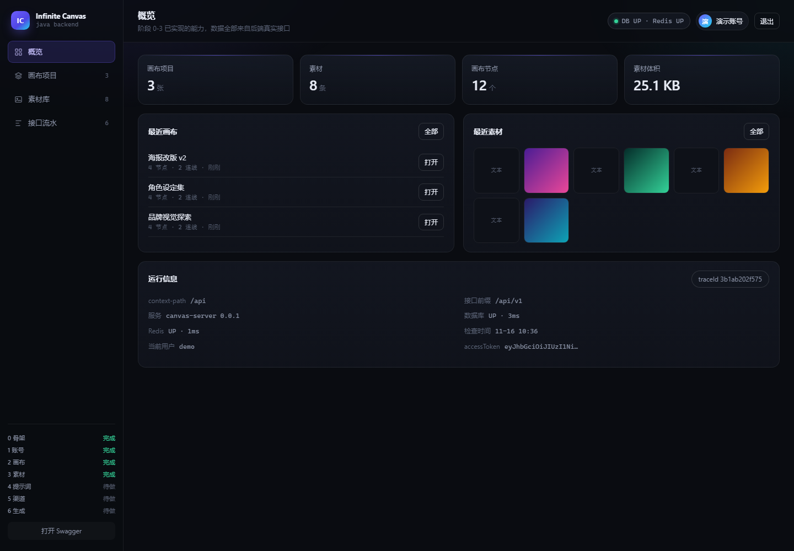
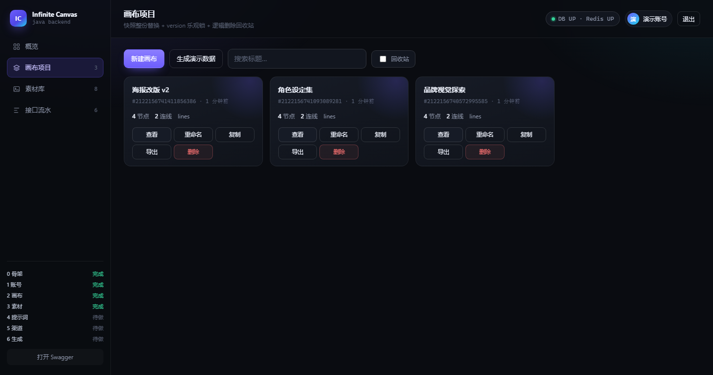
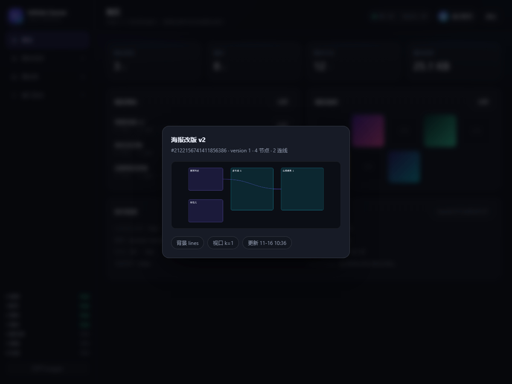
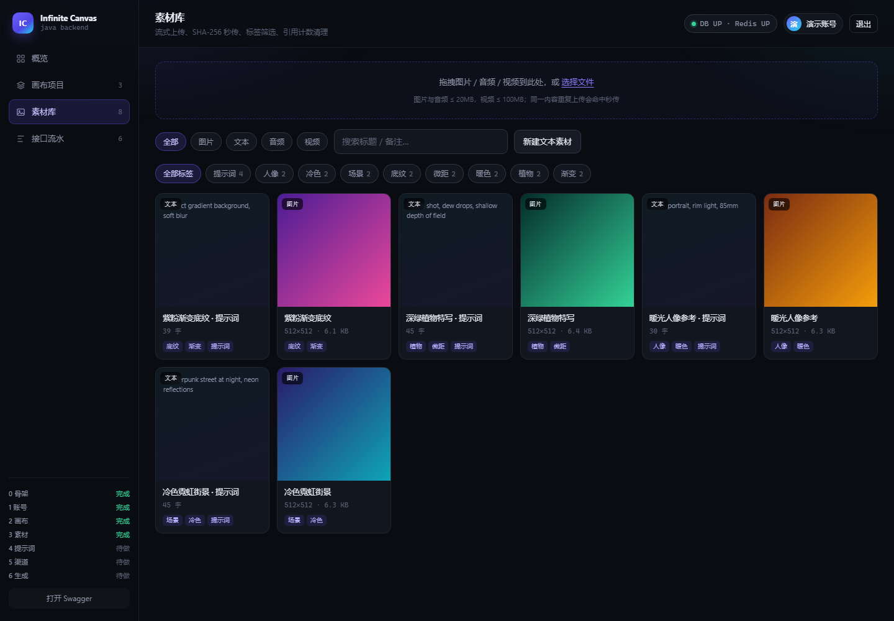

# 阶段 3：文件与素材库

> 目标：把"图片/视频/音频字节"和"素材卡片"这两件事搬上服务端，做出**上传 + 秒传 + 类型校验 + Range 下载 + 素材 CRUD + 标签筛选 + 孤儿清理**。
> 这一阶段第一次碰"二进制"，也是第一次出现"数据库记录和磁盘文件的一致性"问题——它比阶段 2 的纯关系数据更容易出隐形 bug。

📖 技术说明（逐模块 + 面试考点）在 [`tech/`](./tech/README.md)，建议先看 [04 SHA-256 秒传](./tech/04-SHA256秒传与内容寻址.md) 和 [08 媒体访问与 Range](./tech/08-媒体访问与Range下载.md)。

## 一、本阶段完成了什么

| 能力 | 说明 |
| --- | --- |
| multipart 上传 | 流式落盘，边写边算 SHA-256、边卡大小上限，内存占用与文件大小无关 |
| base64 上传 | 直接吃 dataURL，给前端画布"粘贴/截图/生成结果"用 |
| SHA-256 秒传 | 同一用户同一份内容只落一条记录、一份磁盘字节，重复上传返回同一 `fileId` |
| 内容寻址存储 | 路径就是 `{sha256前两位}/{sha256}`，跨用户自动共享同一份字节 |
| 类型与安全校验 | MIME 白名单 + 图片魔数校验（伪装成 png 的 exe 会被拒） |
| 公开媒体访问 | `/api/media/ab/abcdef...` 只读、免 token，`` / `<video>` 能直接用，且带正确 `Content-Type` |
| Range 下载 | `GET /files/{id}/content` 与 `/media/**` 都支持 `bytes=` 区间，视频能拖进度条 |
| 素材 CRUD | 文本/图片/视频/音频四类，逻辑删除、归属隔离 |
| 筛选 | 按 kind / 关键字（标题+来源+备注+正文）/ 标签，分页稳定 |
| 标签聚合 | MySQL 8 `JSON_TABLE` 把标签数组炸成行做 group by |
| 孤儿清理 | 只删"上传后没建成素材"的文件，带宽限期和单批上限 |
| 可视化控制台 | `/api/demo` 单页，把上面所有能力做成可点的界面（见第十一节） |

## 二、交付清单

### 新增源码（23 个 Java + 2 个 XML）

```
infra/storage/
├── StorageProperties.java     配置绑定（root / public-prefix / 三类大小上限）
├── FileStorage.java           存储抽象：只放"字节放哪儿"，不掺业务
├── LocalFileStorage.java      本地实现：内容寻址路径、原子 move、路径越界校验
├── MediaTypes.java            MIME 归一化、白名单、扩展名、魔数校验
├── ImageMetadata.java         只读文件头拿图片宽高（不整图解码）
├── BoundedResource.java       把整份文件裁成 [position, position+count) 交给容器
└── RangeResponse.java         把 Range 头翻译成 200 / 206 / 416 的统一出口

entity/
├── FileRecord.java            t_file（没有逻辑删除，靠引用计数清理）
└── Asset.java                 t_asset（逻辑删除，冗余 bytes/mime/storageKey）

mapper/
├── FileRecordMapper.java      + selectOrphans（NOT EXISTS 反连接）
└── AssetMapper.java           + selectTagCounts（JSON_TABLE）

dto/
├── UploadBase64Request.java
├── CreateAssetRequest.java
└── UpdateAssetRequest.java

vo/
├── FileVO.java                字段名对齐前端 ReferenceImage
├── AssetVO.java               第一层对齐前端 AssetBase
├── AssetDataVO.java           第二层对齐带 kind 判别的 data
├── TagCountVO.java
└── CleanupResultVO.java

service/
├── FileService.java           接口 + 嵌套 record StoredContent
├── AssetService.java
├── impl/FileServiceImpl.java  上传主线 + 秒传 + 引用计数 + 清理
└── impl/AssetServiceImpl.java 素材聚合与筛选

controller/
├── FileController.java        6 个接口（含 Range 内容读取）
├── AssetController.java       6 个接口
└── MediaController.java       公开媒体访问：正确 Content-Type + Range（替代静态映射）

resources/mapper/
├── FileRecordMapper.xml       孤儿文件查询
└── AssetMapper.xml            标签聚合 + 显式构造器映射

resources/static/demo/
├── index.html                 可视化控制台页面
└── app.js                     控制台逻辑（原生 JS，无构建链）
```

### 新增资源

| 文件 | 说明 |
| --- | --- |
| `src/main/resources/db/schema.sql` | 追加 2 张表（`t_file` / `t_asset`） |
| `scripts/stage3-e2e.py` | 12 组、约 40 个断言的全链路脚本，可重复执行 |
| `data/uploads/` | 运行时生成，已被 `.gitignore` 忽略 |

### 修改的已有文件

| 文件 | 改动 |
| --- | --- |
| `common/api/ResultCode.java` | 新增 `UNSUPPORTED_FILE_TYPE(40020)`、`FILE_TOO_LARGE(40021)`、`FILE_EMPTY(40022)`、`FILE_NOT_FOUND(40430)`、`ASSET_NOT_FOUND(40431)`、`FILE_IN_USE(40930)`、`METHOD_NOT_ALLOWED(40500)` |
| `common/constant/ApiPath.java` | 新增 `FILES`、`ASSETS`、`MEDIA` |
| `common/exception/GlobalExceptionHandler.java` | 新增 `MaxUploadSizeExceededException` → 400；新增 `HttpRequestMethodNotSupportedException` → 405（否则错方法会掉成 500） |
| `config/WebMvcConfig.java` | **移除**静态资源映射（改由 `MediaController` 提供，见 tech/08）；保留 CORS 与 `/demo` 重定向；继续挂 `StorageProperties` |
| `config/SecurityConfig.java` | `PUBLIC_PATHS` 放行 `/media/**`（`` 不带 Authorization）与 `/demo/**`（控制台页面） |
| `application.yml` | multipart 上限放到 128MB/160MB；新增 `app.storage.*`；CORS 补 `localhost:3000`（前端 vite 端口） |
| `README.md` / `docs/plan.md` | 目录说明与进度表 |

## 三、启动步骤

前置：MySQL 与 Redis 容器已启动（阶段 0 配好）。

```powershell
cd D:\project\canvas-java
docker compose up -d
docker compose ps             # 两个 healthy 再往下
mvn spring-boot:run
```

启动成功后日志里会多一行，能看到存储根目录有没有按预期解析：

```
文件存储根目录：D:\project\canvas-java\data\uploads，对外访问前缀：/api/media
Tomcat started on port 8081 (http) with context path '/api'
```

两张新表由 `schema.sql` 在启动时自动创建，不需要手动执行 SQL。

## 四、验收

### 1. 一键全跑（推荐）

```powershell
python scripts\stage3-e2e.py
```

脚本自带两个账号（`canvas_demo` / `canvas_other`，密码 `canvas1234`，若不存在先注册），会自己生成 PNG，不依赖本地图片文件，末尾清理测试数据。

### 2. 手工最小验证

```powershell
# 登录拿 token
curl.exe -s -X POST http://127.0.0.1:8081/api/v1/auth/login `
  -H "Content-Type: application/json" `
  -d "{\"account\":\"canvas_demo\",\"password\":\"canvas1234\"}"

# 上传两次同一个文件（第二次应 deduped=true 且 id 相同）
curl.exe -s -X POST http://127.0.0.1:8081/api/v1/files/upload `
  -H "Authorization: Bearer $T" -F "file=@D:\test\red.png"
curl.exe -s -X POST http://127.0.0.1:8081/api/v1/files/upload `
  -H "Authorization: Bearer $T" -F "file=@D:\test\red.png"

# 用返回的 url 直接访问（不需要 token）
curl.exe -I http://127.0.0.1:8081/api/media/ab/abcdef...
```

## 五、判断验收通过的标准

| # | 检查项 | 期望 |
| --- | --- | --- |
| 1 | 启动 | 两张新表自动创建，日志打印存储根目录 |
| 2 | 上传 PNG | `deduped=false`，`width/height` 正确，`url` 形如 `/api/media/a3/a3f9...` |
| 3 | 同一份内容再传 | `deduped=true`，**`id` 与第一次相同** |
| 4 | 不同内容 | 新 `id`、新 `storageKey` |
| 5 | `exe` 改名成 `png` | `400` / `40020`（魔数不符） |
| 6 | `text/plain` | `400` / `40020`（不在白名单） |
| 7 | 空文件 | `400` / `40022` |
| 8 | base64 上传与 multipart 内容相同 | 命中秒传，同一个 `fileId` |
| 9 | 非法 base64 | `400` / `40000` |
| 10 | 公开地址（无 token） | `200`，`Content-Type` 是 `image/png`（**不是 `application/octet-stream`**），`Content-Length` 正确 |
| 11 | `Range: bytes=0-9` | `206`，`Content-Range: bytes 0-9/N`，收到 10 字节 |
| 12 | `?download=true` | `Content-Disposition: attachment` |
| 13 | `/content` 不带 token | `401` / `40100` |
| 14 | 建文本素材 | `data.content` 有值，`data` 里没有 width/mimeType |
| 15 | 建图片素材 | `coverUrl` 自动填成文件地址；`width/height/bytes/mimeType` 来自文件 |
| 16 | 用 png 建 video 素材 | `400` / `40000`（类型不匹配） |
| 17 | 文本素材不传 `content` | `400` / `40000` |
| 18 | 列表筛选 | `kind` / `keyword`（备注、正文也能命中）/ `tag` 三种都对 |
| 19 | `size=500` | 被压到 `100` |
| 20 | 标签聚合 | 返回 `[{tag, count}]`，count 倒序 |
| 21 | PATCH 改标题+标签 | `updatedAt` 变新，标签整体替换 |
| 22 | `tags: []` | 标签被清空 |
| 23 | 给图片素材改 `content` | `400`（只有文本素材能改正文） |
| 24 | 删被引用的文件 | `409` / `40930` |
| 25 | 越权查文件/素材 | `404` / `40430`、`40431`（不是 403） |
| 26 | `cleanup` 默认宽限期 | 刚上传的文件不会被清掉 |
| 27 | `cleanup?graceMinutes=0` | 孤儿被删，`GET /files/{id}` 变 404；被引用的文件不受影响 |
| 28 | 删素材后 | 列表查不到（逻辑删除），磁盘文件仍在 |

## 六、验证状态

**已在本机跑通全链路**（2026-11-16）。环境：Windows + Docker Desktop，MySQL 8.0 跑在 3307、Redis 7 跑在 6380，应用 8081。

```powershell
cd D:\project\canvas-java
mvn -o spring-boot:run          # 另一个窗口
python scripts\stage3-e2e.py
```

真实输出（节选，脚本共 12 组断言）：

```
========== 1. multipart 上传 ==========
上传 red.png         HTTP 200 code=0 {"id":"2122154595580723201","mimeType":"image/png",...}

========== 2. 同一份内容再传一次（秒传）==========
秒传                 HTTP 200 code=0 {"id":"2122154595580723201","deduped":true,...}
同一 fileId          True   sha256 一致 True

========== 4. 类型校验 ==========
exe 伪装成 png        HTTP 400 code=40020 "文件内容与声明的类型不符（声明的 image/png）"
text/plain           HTTP 400 code=40020 "不支持的文件类型：text/plain"
空文件                HTTP 400 code=40022 "文件内容为空"

========== 6. 静态地址与 Range ==========
GET 静态地址（无 token）   HTTP 200 content-type=image/png content-length=779 字节数对=True
GET content Range 0-9   HTTP 206 content-range=bytes 0-9/779 收到字节=10 accept-ranges=bytes
GET content 不带 token    HTTP 401

========== 8. 列表 / 搜索 / 标签 ==========
kind=image / keyword=赛博 / tag=测试 / keyword=e2e（命中备注）  全部命中
size=500 被压制         HTTP 200 {"pageSize": 100}
标签聚合               [{"tag":"夜景","count":2},{"tag":"测试","count":2},...]

========== 10. 删除保护与越权 ==========
删被素材引用的文件        HTTP 409 code=40930 "文件已被 2 个素材引用，请先删除对应素材"
别的用户查我的文件/素材    HTTP 404 code=40430 / 40431（不是 403）

========== 11. 孤儿清理 ==========
cleanup（默认宽限 1440）  {"scanned":0,"removedFiles":0}      ← 刚上传的没被清
cleanup graceMinutes=0   {"scanned":2,"removedFiles":2,"freedBytes":853}
孤儿文件已删除            HTTP 404 code=40430
被引用的文件不受影响      HTTP 200
```

### 实测中发现并修掉的三个真问题

这三个都是"不跑就永远发现不了"的类型，记录下来比通过项更有价值：

| # | 现象 | 根因 | 修复 |
| --- | --- | --- | --- |
| 1 | `POST /v1/files/upload` 返回 500 "服务暂时不可用" | Controller 上写的是 `@PostMapping`（无路径），实际映射成 `POST /v1/files`；文档和脚本用的是 `/files/upload`，请求落到了 `GET /v1/files/{id}` 的模式上 → 405 → 被兜底成 500 | `@PostMapping("/upload", ...)`；同时补上 405 的专属 handler，让"方法不对"不再伪装成 500 |
| 2 | `Range: bytes=0-9` 返回 500，`No converter for [ResourceRegion] with preset Content-Type 'image/png'` | 方法声明成 `ResponseEntity<?>` 以兼容"有/无 Range"，但 Spring 拿不到 body 的静态类型，判定 `ResourceRegionHttpMessageConverter` 写不了 | 新增 `BoundedResource`，两个分支都返回 `Resource`，统一走 `ResourceHttpMessageConverter`（见 tech/08） |
| 3 | `cleanup?graceMinutes=0` 返回 `scanned=0`，孤儿永远清不掉 | Service 里写的是 `graceMinutes <= 0 ? 24*60 : graceMinutes`，把"0"当成了"没传"，与文档承诺的"传 0 强制清理"相反；另外 SQL 用 `created_at < now` 会漏掉同一秒创建的文件 | 改成 `graceMinutes < 0` 才回落默认值；SQL 改 `<=` |

### 控制台页面验证

```powershell
start http://127.0.0.1:8081/api/demo
```

页面里点「生成演示数据」，会通过真实接口创建 3 张画布（每张 4 节点 2 连线）、4 张图片素材、2 条文本素材；「接口流水」页能逐条看到请求与响应。图片能正常显示，说明 `Content-Type` 与 `nosniff` 的问题已经解决。

## 七、本阶段要掌握的知识点

1. **为什么文件不进数据库**：BLOB 会让备份、迁移、CDN 全部变难；小文本进库、大二进制出库的分界线在哪。
2. **内容寻址 vs UUID 命名**：秒传、去重、幂等、完整性校验四个好处，以及"删除变成引用计数问题"这个代价。
3. **流式上传**：为什么不能 `file.getBytes()`，64KB 缓冲 + `MessageDigest` 边写边算。
4. **临时文件必须同文件系统**：否则 `ATOMIC_MOVE` 退化成"复制+删除"。
5. **客户端 MIME 不可信**：白名单 + 魔数校验，以及为什么视频/音频不自己手写魔数。
6. **图片宽高只读文件头**：`ImageIO.read` 的 OOM 风险，`ImageReader` 的常数级内存。
7. **公开媒体访问 vs 鉴权下载**：`` 不带 header 的现实约束、内容寻址的安全边界、生产该用预签名 URL；以及 `X-Content-Type-Options: nosniff` 为什么会把 `octet-stream` 的图片变成破图。
8. **Range 请求**：206 / `Content-Range` / `Accept-Ranges`，视频拖进度条到底依赖什么。
9. **JSON 列做标签**：`JSON_CONTAINS` 过滤、`JSON_TABLE` 聚合，什么时候该拆关联表。
10. **一致性**：DB 记录与磁盘文件谁先谁后、失败了怎么办、为什么不加分布式事务。

## 八、常见问题

| 现象 | 原因 | 处理 |
| --- | --- | --- |
| 启动报 `Cannot create directory` | `app.storage.root` 指向了无权限路径 | 用相对路径 `./data/uploads` 或绝对路径 |
| 上传 400 / `40020` | MIME 不在白名单，或图片魔数与声明不符 | 检查真实文件类型，不要只改扩展名 |
| 上传 413 / `40021` | 超过容器或业务上限 | 看 `spring.servlet.multipart.max-file-size` 与 `app.storage.max-*-size` |
| 秒传不生效 | 内容真的不一样（重新编码过、加了元数据） | 用 `sha256sum` 对比两份文件 |
| `url` 打不开 401 | 访问的是 `/v1/files/{id}/content` | 公开地址是 `/api/media/...` |
| `url` 打不开 404 | storageKey 不符合 `两位hex/64位hex`，或 `t_file` 里没有这条记录，或磁盘文件已被清理 | 查 `t_file.storage_key` 与 `data/uploads` 是否一致 |
| 图片能访问但浏览器不显示 | 响应头是 `application/octet-stream` + `nosniff`，说明 `/media/**` 又退回了静态映射 | 确认 `MediaController` 生效（`Content-Type` 应是真实 MIME） |
| 视频不能拖进度条 | 用了 `out.write()` 手写输出 | 必须支持 Range（见 tech/08） |
| 图片能传但 `width` 为 null | 格式是 WebP，JDK 自带 ImageIO 不认 | 已知取舍，需要时引 TwelveMonkeys |
| 删素材后磁盘还在涨 | 设计如此：清理只针对"从未被引用"的孤儿 | 见 tech/11 |
| `JSON_TABLE` 报语法错 | MySQL < 8.0 | 本项目要求 8.0+ |

## 九、已知取舍与后续

| 取舍 | 说明 | 什么时候补 |
| --- | --- | --- |
| 本地磁盘 | 单机、无副本，多实例部署会各存各的 | 阶段 8 换 MinIO，只需新写一个 `FileStorage` 实现 |
| 不生成缩略图 | 列表直接用原图，20 张 4K 图会很吃力 | 需要时加 Thumbnailator + `thumb_key` 列 |
| 素材删除不回收字节 | 逻辑删除可恢复优先 | 素材回收站 + 定时任务一起做 |
| 清理需手动触发 | 自动清理有误删风险 | 阶段 8 加 `@Scheduled`，但保留宽限期 |
| 单区间 Range | 不支持 `multipart/byteranges` | 浏览器几乎不用，收益极低 |
| 无图片压缩/转码 | 存什么给什么 | 需要 WebP 转换时上 `cwebp` 或 ImageIO 插件 |
| `biz_type` 只做标记 | 没有按业务类型分别限流/限额 | 有配额需求时再加 `t_user_quota` |

## 十一、可视化控制台

Swagger 能验证接口，但看不出"素材库长什么样"。所以本阶段附带了一个单页控制台：

```
http://127.0.0.1:8081/api/demo        （会 302 到 /api/demo/index.html）
```

| 页签 | 能做什么 |
| --- | --- |
| 概览 | 画布数 / 素材数 / 节点数 / 素材体积，最近画布与最近素材，DB 与 Redis 的实时探针 |
| 画布项目 | 新建、查看（把节点按坐标画成缩略图）、重命名、复制、导出 JSON、删除、回收站恢复 |
| 素材库 | 拖拽上传（真实走 multipart + 秒传）、图片网格、按 kind / 关键字 / 标签筛选、改标签、建文本素材、删除 |
| 接口流水 | 每个请求的方法、业务码、HTTP 状态、耗时，点开看完整请求体与响应体 |

另外有一个「生成演示数据」按钮：一次性建 3 张带节点的画布 + 4 张程序生成的图片 + 2 条文本素材，用来快速看效果或截图。也可以不开浏览器直接灌：

```powershell
python scripts\seed-demo.py
```

### 界面

概览：统计卡 + 最近画布 + 最近素材 + 运行信息（DB / Redis 探针、当前 traceId）。



画布项目：卡片显示节点/连线数，支持查看、重命名、复制、导出、删除，右上可切回收站。



点「查看」会把快照按节点真实坐标等比画成缩略图（这张是 4 节点 2 连线的演示画布）：



素材库：拖拽上传、类型筛选、标签聚合、图片网格、改标签、删除。



**为什么放在 `resources/static/demo`**：和接口同源，不用配 Vite 代理、不用处理跨域，`mvn spring-boot:run` 就能看。代价是它属于"只读演示"，不参与前端业务——正式前端仍在 `infinite-canvas-main/web`，对接是阶段 9 的事。

**它和 Swagger 的分工**：Swagger 用来调单个接口、看字段约束；控制台用来确认"一串接口串起来后业务是否成立"（比如上传 → 建素材 → 列表筛选 → 删素材 → 清理）。

安全上：页面本身不含数据，`/demo/**` 已在 `SecurityConfig` 放行；所有业务数据仍要带 token 拉取。生产环境应该把这段静态资源排除掉，或者挪到独立的内部工具站。

## 十二、下一阶段

**阶段 4：提示词库**。会用到本阶段的能力：

- 提示词源的"参考图"可以直接复用 `/files/upload`；
- 素材的"标签 + 关键字 + 分页"这套筛选写法，提示词库会原样再用一遍；
- 定时刷新任务会第一次引入 `@Scheduled` 和分布式锁，是阶段 6 任务队列的铺垫。
